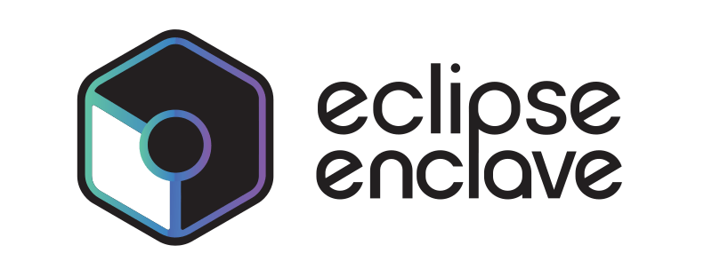
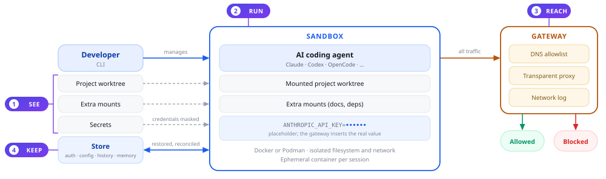

<h1 align="center">
  <picture>
    <source media="(prefers-color-scheme: dark)" srcset="docs/assets/enclave-logo-horizontal-darkbg.png">
    
  </picture>
</h1>

<p align="center">
  <a href="https://enclave.eclipse.dev">Website</a> ·
  <a href="https://enclave.eclipse.dev/docs/getting-started">Getting Started</a> ·
  <a href="docs/README.md">Docs</a> ·
  <a href="CONTRIBUTING.md">Contributing</a>
</p>

Run AI coding agents in full autonomy without giving them your host. Enclave
runs Claude Code, Codex, Copilot, OpenCode, or Pi in an isolated container, and
attaches the Theia IDE to one. More tools, such as Amp and Antigravity, are in
[enclave-extensions](https://github.com/eclipse-enclave/enclave-extensions).

<p align="center">
  <picture>
    <source media="(prefers-color-scheme: dark)" srcset="website/docs/static/img/architecture-dark.svg">
    
  </picture>
</p>

1. See: the agent sees your project worktree and the extra mounts you choose.
   Secrets that the gateway can insert into requests reach it only as
   placeholders. The rest of the host stays out of reach.
2. Run: the agent runs in YOLO mode, without confirmation prompts, in a
   container per session on Docker or Podman.
3. Reach: all traffic leaves through a gateway that allows only allowlisted
   domains and logs what it allows and blocks.
4. Keep: logins, config, history, and agent memory persist on the host across
   sessions.

## Quick start

### 1. Check the prerequisites

- Linux, macOS, or Windows through [WSL2](docs/windows.md)
- Rootful Docker with buildx, or Podman (rootless works)
- Git 2.26 or newer, with an author and committer identity configured

Details and setup commands: [Installation](docs/install.md#requirements).

### 2. Install

Download from the
[rolling release](https://github.com/eclipse-enclave/enclave/releases/tag/rolling):

```bash
sudo apt install ./enclave_*_amd64.deb     # Ubuntu 24.04, x86-64
sudo dnf install ./enclave-*.x86_64.rpm    # Fedora, x86-64
```

Standalone binaries for Linux and macOS (x86-64 and arm64) update themselves
with `enclave self-update`. See
[Getting Started](https://enclave.eclipse.dev/docs/getting-started) for each
platform, or [Installation](docs/install.md) for all options, including
building from source.

### 3. Run

Run Enclave as a regular user from a project directory:

```bash
cd my-project
enclave
```

The first interactive run asks which agent to use and saves the answer as
`"tool"` in `~/.config/enclave/config.json`. Log in from inside the agent once;
the login is saved and reused on later runs.

| Command | What it does |
|---------|--------------|
| `enclave` | Start a session with the configured agent |
| `enclave --tool codex` | Use a different agent for one run |
| `enclave continue` | Continue the latest session |
| `enclave --background` | Start a session you can detach from |
| `enclave attach [name]` | Reattach to a background session |
| `enclave ps` | List running sessions (`--all`, `--json`) |
| `enclave shell` | Open a shell in the container |
| `enclave network log` | Show what the agent tried to reach |
| `enclave info` | Show config and image details |

Good to know:

- A foreground session ends with its terminal. Closing it, or pressing
  `Ctrl-\`, stops the container.
- Without a complete Git author and committer identity, Enclave exits before
  starting the container; see [Git](docs/git.md).
- Enclave refuses to run as root and to mount your home directory or other
  sensitive paths; see [Installation](docs/install.md#running-as-root) and
  [Mounts](docs/mounts.md).

## What you get

| Area | Summary | Docs |
|------|---------|------|
| Agents | Six built-in tools, more as extensions; per-tool images and automatic updates | [Tools and images](docs/tools.md) |
| Network | Allowlist-based egress through a gateway, audit log, host port bridging | [Networking](docs/networking.md) |
| Auth | OAuth logins saved per tool, layered secrets files, credentials kept out of the container | [Authentication](docs/auth.md) |
| Sessions | Named and background sessions, persistent history, caches, and agent memory | [Sessions and persistence](docs/persistence.md) |
| Configuration | Global and per-project config, tool config overrides, skills, and patches | [Configuration](docs/configuration.md), [Tool config](docs/tool-config.md) |
| Extensions | Install tools, features, and commands from Git, or write your own | [Extensions](docs/extensions/README.md) |
| Custom commands | Your own `enclave <name>` verbs, run on the host or in a session | [Commands](docs/commands.md) |
| Backends | Docker, Podman, and an experimental QEMU microVM backend | [Backends](docs/backends.md) |
| Security | What the sandbox protects against and what it does not | [Security](docs/security/README.md) |

All commands and flags: [CLI reference](docs/cli-reference.md). The full index
is in [docs/README.md](docs/README.md).

## Contributing

See [CONTRIBUTING.md](CONTRIBUTING.md) for build instructions, where changes
go, and the pull request checklist. The [Developer Guide](docs/DEV.md) and
[Architecture](docs/ARCHITECTURE.md) cover the codebase in depth.

Project resources: [website](https://enclave.eclipse.dev),
[Eclipse project page](https://projects.eclipse.org/projects/ecd.enclave),
[security policy](SECURITY.md), [code of conduct](CODE_OF_CONDUCT.md),
[license](LICENSE) (MIT), and [notices](NOTICE.md).
