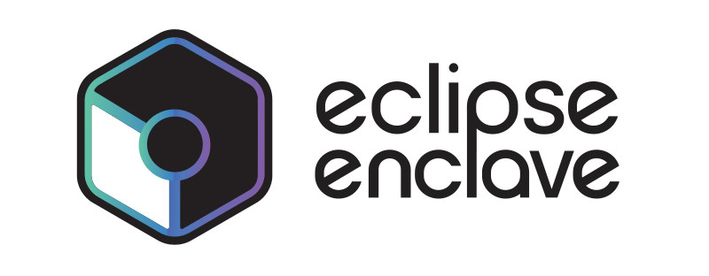

<h1 align="center">
  <picture>
    <source media="(prefers-color-scheme: dark)" srcset="docs/assets/enclave-logo-horizontal-darkbg.png">
    
  </picture>
</h1>

A sandbox for running agentic coding tools in an isolated container, on Docker or rootless Podman, while keeping your project files on the host. Claude Code, Codex, Copilot, OpenCode, Pi, and Theia are built in; [enclave-extensions](https://github.com/eclipse-enclave/enclave-extensions) adds more, such as Amp and Antigravity. Network access is restricted to allowlisted domains by default, auth and history persist across sessions, and YOLO mode is on so agents can act without confirmation prompts.

<a href="https://enclave.eclipse.dev">Website</a> · <a href="https://enclave.eclipse.dev/docs/getting-started">Getting Started</a> · <a href="https://enclave.eclipse.dev/docs">Docs</a>

## Requirements

- Linux or macOS. On Windows, Enclave runs inside WSL2 and `enclave.exe` is a
  launcher that forwards to it; see [Windows](docs/windows.md).
- One container engine: rootful Docker with the buildx plugin, or rootless
  Podman, which needs no daemon and no privileged group. Enclave detects
  whichever is installed; see [Podman backend](docs/cli-reference.md#podman-backend)
  for its limits.
- Git 2.26 or newer.

Run enclave as your regular user, from a project directory: it refuses to run as
root or to mount your home directory and other sensitive host data. Engine setup
per distribution, the `docker` group, and the optional QEMU backend are covered
in [Installation](docs/install.md).

## Installation

Packages and binaries come from the
[rolling release](https://github.com/eclipse-enclave/enclave/releases/tag/rolling).
The `.deb` and `.rpm` depend on Docker; Podman-only hosts use the binary.

```bash
sudo apt install ./enclave_*_amd64.deb        # Ubuntu 24.04, x86-64
sudo dnf install ./enclave-*.x86_64.rpm       # Fedora, x86-64
```

For the standalone binary, download the artifact for your platform together
with `checksums.txt`, verify it, and install it into a directory on your `PATH`
that you own, so `enclave self-update` can replace it later:

```bash
sha256sum --check --ignore-missing checksums.txt   # shasum -a 256 on macOS
install -d ~/.local/bin
install enclave-linux-amd64 ~/.local/bin/enclave
```

To build from source, with Make and Go 1.24 or newer:

```bash
git clone https://github.com/eclipse-enclave/enclave.git
cd enclave
make install
```

[Installation](docs/install.md) has the details: the macOS quarantine step,
shell completion, update channels and automatic updates, and the Windows
launcher.

## Quick start

Run in any project directory:

```bash
enclave                     # Start the current project's tool (asks which one on the first run)
enclave --tool codex        # Use a different tool for one run
enclave --backend podman    # Use Podman for one run (auto-detected when it is the only engine)
enclave --backend qemu --tool codex  # Experimental QEMU microVM run (implies --slim, all-network)
enclave continue            # Continue latest session
enclave ps                  # List running containers (--all for stopped, --json for scripts)
enclave exec                # Attach to running container
enclave shell               # Open interactive shell in container
enclave info                # Show config and image details
enclave version             # Show binary version and source commit (--json; alias: --version)
```

Sessions require a configured Git author and committer identity, even outside a Git repository. If either is incomplete, enclave exits before starting the container; see [Git identity](docs/persistence.md#git).

The first interactive session asks which coding agent to run and saves the answer as `"tool"` in `~/.config/enclave/config.json`; later runs start it without asking. Scripts and non-terminal runs are never asked: without a configured tool they fail with a message naming `--tool` and the `tool` key. See [Tool selection](docs/cli-reference.md#tool-selection).

A session ends with its terminal: closing the terminal, or typing `Ctrl-\` (the key `enclave attach` detaches with), stops the container and removes its gateway. Use `--background` for a session you can detach from and reattach to with `enclave attach`.

To authenticate, log in from inside the container on the first run. OAuth sessions are saved to an auth store on the host and reused on later runs, so no further configuration is needed. To use declared env credentials instead, place them in `~/.local/state/enclave/secrets/global.env`. See [Authentication & Secrets](docs/auth.md).

For the full command and flag reference, see [docs/cli-reference.md](docs/cli-reference.md).

## Custom commands

An executable dropped into `~/.config/enclave/commands/host/<name>` becomes an
`enclave <name>` verb that runs on the host; under `commands/session/<name>` it
runs inside a sandboxed session container instead. Installed extensions can
ship host commands too. See [Custom commands](docs/cli-reference.md#custom-commands).

## Learn more

| Topic | Doc |
|-------|-----|
| Installation | [docs/install.md](docs/install.md) |
| CLI Reference | [docs/cli-reference.md](docs/cli-reference.md) |
| Podman backend | [docs/cli-reference.md#podman-backend](docs/cli-reference.md#podman-backend) |
| Development | [docs/DEV.md](docs/DEV.md) |
| Authentication & Secrets | [docs/auth.md](docs/auth.md) |
| Networking | [docs/networking.md](docs/networking.md) |
| Tool Profiles & Images | [docs/tools.md](docs/tools.md) |
| Sessions & Persistence | [docs/persistence.md](docs/persistence.md) |
| Configuration | [docs/configuration.md](docs/configuration.md) |
| Windows (WSL2) | [docs/windows.md](docs/windows.md) |
| Architecture | [docs/ARCHITECTURE.md](docs/ARCHITECTURE.md) |
| Extensions | [docs/extensions/README.md](docs/extensions/README.md) |
| Installing Extensions from Git | [docs/extensions/installing.md](docs/extensions/installing.md) |
| More tools and features | [enclave-extensions](https://github.com/eclipse-enclave/enclave-extensions) |
| Security | [docs/security/README.md](docs/security/README.md) |

Project resources: [website](https://enclave.eclipse.dev),
[Eclipse project page](https://projects.eclipse.org/projects/ecd.enclave),
[contributing guide](CONTRIBUTING.md), [security policy](SECURITY.md),
[code of conduct](CODE_OF_CONDUCT.md), [license](LICENSE.md), and
[notices](NOTICE.md).
