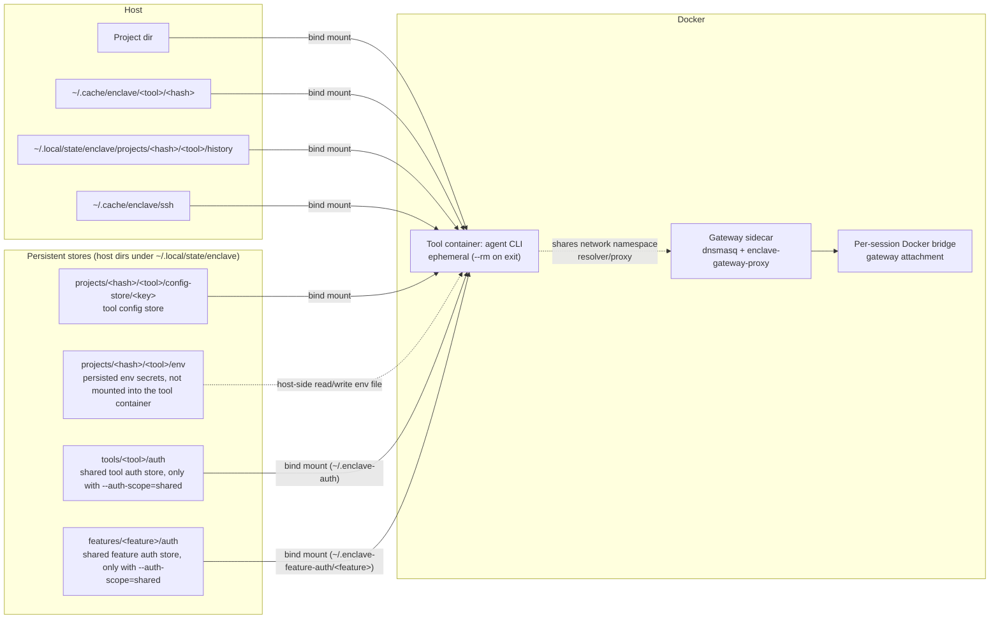
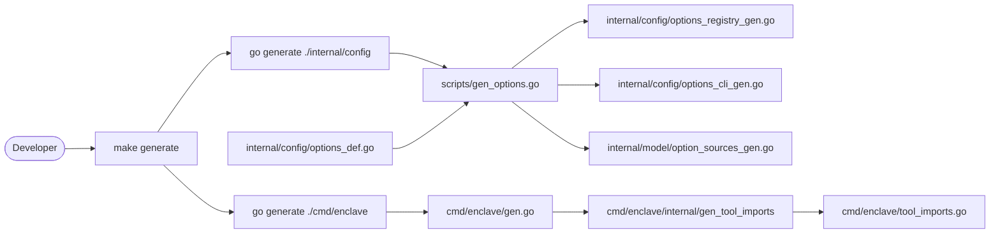

# Architecture

How Enclave's code is organized and how a session comes together. The Go code
lives in small packages under `internal/` behind a thin CLI entrypoint in
`cmd/`. Sessions run in Docker or Podman containers, or in an experimental QEMU
microVM ([backends.md](backends.md)). Build and test commands are in
[DEV.md](DEV.md).

## High-level flow

1. Parse CLI arguments, load host configuration, and resolve the tool profile.
   Standalone release binaries check for updates at most daily
   ([Updating](install.md#updating), [Self-update](#self-update)).
2. Discover repository assets (Dockerfiles, runtime assets, profiles).
3. Ensure the runtime image is current, rebuilding if needed:
   - Rebuild detection hashes the rendered Dockerfile and entrypoint plus build
     config (target, base image or devcontainer, features, agent tools).
   - A side-effect-free agent update planner runs before the rebuild gate. Once
     the interval has elapsed, tools with `check-update.sh` are probed in a
     controlled container, and only changed fingerprints request a rebuild.
   - Update stamps and fingerprints are committed only after a successful
     build. Per-tool stages scope cache invalidation to the updated tool.
   - `--no-rebuild` / `ENCLAVE_NO_REBUILD=1` skips probes and all image builds
     ([Suppressing rebuilds](tools.md#suppressing-rebuilds)).
4. Prepare mounts, persistent stores, auth, and network isolation.
5. Run the tool or shell inside an ephemeral container.

## Diagrams

### Docker runtime

### Go code generation

The network request flow, restricted and unrestricted, has separate
[sequence diagrams](runtime/network-request-flow.md).

## Repository layout

### Entry points

| Path | Purpose |
|------|---------|
| [`cmd/enclave/main_unix.go`](../cmd/enclave/main_unix.go) | Entrypoint except on Windows; loads the asset variant and calls `app.Run` |
| [`cmd/enclave/main_windows.go`](../cmd/enclave/main_windows.go) | Windows entrypoint; delegates to the [WSL launcher](#windows-launcher) |
| [`cmd/enclave-gateway-proxy/main.go`](../cmd/enclave-gateway-proxy/main.go) | Gateway MITM proxy, used by `Dockerfile.gateway` |

### Distribution assets

| Path | Purpose |
|------|---------|
| [`assets_embed.go`](../assets_embed.go) | Embeds the build context, docs, extensions, and gateway proxy sources in standalone binaries |
| [`assets_noembed.go`](../assets_noembed.go) | Used by deb/rpm builds (`enclave_no_embed` tag), which install the tree next to the executable |
| [`internal/appassets/`](../internal/appassets/) | Registers the embedded filesystem, its content key, and extraction modes |
| [`internal/config/embedded_assets.go`](../internal/config/embedded_assets.go) | Extracts assets into the content-keyed cache ([details](DEV.md#how-the-binary-finds-its-assets)) |
| [`internal/legacyassets/`](../internal/legacyassets/) | Removes only exact, known files of older source installs; keeps unknown files, never follows symlinks or recurses |
| [`debian/`](../debian/), [`packaging/rpm/`](../packaging/rpm/), [`packaging/scoop/`](../packaging/scoop/) | Packaging; the release workflows fill URLs and hashes into the Scoop template |
| [`scripts/version.sh`](../scripts/version.sh) | The only version source ([Versions](RELEASING.md#versions)) |
| [`.github/workflows/`](../.github/workflows/), [`.github/actions/publish-downloads/`](../.github/actions/publish-downloads/) | Release builds and uploads ([RELEASING.md](RELEASING.md)) |

### Orchestration (`internal/app/`)

| Path | Purpose |
|------|---------|
| [`app.go`](../internal/app/app.go) | Parsing, defaults merging, command dispatch |
| [`root_guard.go`](../internal/app/root_guard.go) | Root refusal ([Root guard](#root-guard)) |
| [`mount_guard.go`](../internal/app/mount_guard.go) | Sensitive-mount refusal ([Mount guard](#mount-guard)) |
| [`commands.go`](../internal/app/commands.go) | Routes commands to handlers |
| [`command_run.go`](../internal/app/command_run.go) | run, continue, resume, exec, and shell flow |
| [`build.go`](../internal/app/build.go) | Rebuild detection, agent update planning, stamp commits |
| [`self_update.go`](../internal/app/self_update.go), [`internal/selfupdate/`](../internal/selfupdate/) | Update policy; channel resolution and checksum-verified atomic install ([Self-update](#self-update)) |
| [`cleanup.go`](../internal/app/cleanup.go) | `enclave cleanup` |
| [`ssh.go`](../internal/app/ssh.go) | `enclave ssh-init` |
| [`tools.go`](../internal/app/tools.go) | Lists tool profiles |
| [`network_cmd.go`](../internal/app/network_cmd.go), [`network_log_cmd.go`](../internal/app/network_log_cmd.go) | `enclave network` subcommands and `network log` |
| [`internal/cli/network_command.go`](../internal/cli/network_command.go) | Cobra tree for `network` |
| [`internal/extinstall/`](../internal/extinstall/) | `enclave tools|features|commands add|update|remove` |

### Configuration and profiles

| Path | Purpose |
|------|---------|
| [`extensions/tools/`](../extensions/tools/) | Per-tool `spec.yaml`, templates, allowlists, install and `check-update.sh` scripts |
| [`internal/config/paths.go`](../internal/config/paths.go) | Resolves the app root (`ENCLAVE_HOME`, adjacent tree, or embedded store) |
| [`internal/config/profile.go`](../internal/config/profile.go) | Loads and lists tool profiles |
| [`internal/domainpattern/pattern.go`](../internal/domainpattern/pattern.go) | Strict domain patterns for secret release hosts |

### Runtime execution

| Path | Purpose |
|------|---------|
| [`internal/runtime/runtime.go`](../internal/runtime/runtime.go) | Coordinates mounts, stores, auth, network, and execution through the backend |
| [`internal/runtime/`](../internal/runtime/) `auth_manager.go`, `volume_manager.go`, `network_manager.go`, `command_builder.go` | Focused runtime concerns |
| [`internal/runtime/secret_mapping.go`](../internal/runtime/secret_mapping.go) | `SecretMapping`: placeholder release rules passed to the gateway |
| [`internal/backend/`](../internal/backend/) | Backend-neutral session contract; [`docker/`](../internal/backend/docker/) (also Podman) and [`qemu/`](../internal/backend/qemu/) implement it |
| [`internal/docker/`](../internal/docker/) | Wraps the Docker or Podman CLI |
| [`internal/mounts/mounts.go`](../internal/mounts/mounts.go) | Mount path validation, worktrees, port mapping |
| [`internal/mounts/sensitive.go`](../internal/mounts/sensitive.go) | The sensitive-path rule ([mounts.md](mounts.md#sensitive-mounts)) |
| [`internal/auth/auth.go`](../internal/auth/auth.go) | Layered secrets, auth file copies, Claude-specific config |
| [`internal/placeholderstore/`](../internal/placeholderstore/) | Internal native credential projection, stable bindings and native-path classification; no protected workload startup yet |
| [`internal/auth/secret_injection.go`](../internal/auth/secret_injection.go) | `PlaceholderResolver`: random `ENCLAVE_SECRET_*` placeholders |
| [`internal/gateway/gateway.go`](../internal/gateway/gateway.go) | Sidecar container and network; keeps logs until explicit removal, removes by immutable ID |
| [`internal/gateway/bundle/`](../internal/gateway/bundle/bundle.go) | Host-managed bundles (`dnsmasq.conf`, `domains.txt`, `meta.json`) for apply and reload |
| [`internal/gateway/mitm/`](../internal/gateway/mitm/) | TLS MITM, allowlist checks, placeholder rewriting; writes events through `internal/netlog` |
| [`internal/gateway/dnsaudit/`](../internal/gateway/dnsaudit/) | Turns dnsmasq denials into `dns` events; own process (`enclave-gateway-proxy -dns-audit <log>`), so it works without the proxy |
| [`internal/gateway/wsframe/`](../internal/gateway/wsframe/) | Shared RFC 6455 frame parser; unmasks payloads without taking part in the connection |
| [`internal/gateway/tlsstore/`](../internal/gateway/tlsstore/) | CA and container-private leaf cache; only the CA reaches the host |

### Tools, network policy, and devcontainers

| Path | Purpose |
|------|---------|
| [`internal/tools/handler.go`](../internal/tools/handler.go), [`extensions/tools/<tool>/go/`](../extensions/tools/) | Handler hooks and per-tool registrations (ports, validation) |
| [`internal/netlog/`](../internal/netlog/) | Audit log format (`Event`) and file handling; no Docker, policy, or CLI knowledge |
| [`internal/netlogview/`](../internal/netlogview/) | Log queries and capture rendering (`network log --show-capture`), kept out of `netlog` so the sidecar does not ship it |
| [`internal/netcapture/`](../internal/netcapture/) | Full capture format, body and WebSocket message writers, released-secret redaction, host directory setup, pruning, and lookup |
| [`internal/network/`](../internal/network/) | `network.jsonc` policy loading, merging, dnsmasq config generation |
| [`internal/policy/effective_resolver.go`](../internal/policy/effective_resolver.go) | Effective policy for startup, `network status`, and apply |
| [`internal/policy/session_inputs.go`](../internal/policy/session_inputs.go) | A session's policy contributions, shared by startup and the `network status`/`print`/`diff` preview |
| [`internal/app/network_helpers.go`](../internal/app/network_helpers.go) | Finds running gateways, verifies bundle mounts, confirms reloads |
| [`internal/devcontainer/`](../internal/devcontainer/) | Generates `devcontainer.json` |

### Windows launcher

[`internal/wslshim/`](../internal/wslshim/) maps the Windows working directory
to a distribution and Linux path, resolves the Linux `enclave` in one preflight
round trip, builds the command line itself so arguments survive `wsl.exe`,
constructs `WSLENV`, and propagates the exit code. It depends only on the
standard library, [`internal/envflag/`](../internal/envflag/), and
`golang.org/x/sys/windows` plus `mpr.dll`; only `GetDriveType` and
`WNetGetConnection` (behind one-method seams) touch Win32. It links no assets or
extensions, hence the `//go:build !windows` on
[`cmd/enclave/tool_imports.go`](../cmd/enclave/tool_imports.go). Testing:
[DEV.md](DEV.md#windows-launcher); behavior: [windows.md](windows.md).

### Shared types and utilities

| Path | Purpose |
|------|---------|
| [`internal/model/types.go`](../internal/model/types.go) | Core types and constants |
| [`internal/util/util.go`](../internal/util/util.go) | Hashing, path checks, string helpers |
| [`internal/envflag/`](../internal/envflag/) | On/off env switches; stdlib only, since the launcher imports it |
| [`internal/logx/logx.go`](../internal/logx/logx.go) | Logging with color and debug level |
| [`internal/testutil/`](../internal/testutil/) | Shared test helpers, such as HOME write snapshots |
| [`internal/usercmd/usercmd.go`](../internal/usercmd/usercmd.go) | User and extension command discovery ([below](#user-defined-and-extension-commands)) |

### Container assets

| Path | Purpose |
|------|---------|
| [`Dockerfile`](../Dockerfile) | Runtime image: `tool-base` -> `feature-base` -> `standard` plus per-tool stages; contexts and hashes scoped to the selected tools and features |
| [`Dockerfile.gateway`](../Dockerfile.gateway) | Gateway image (DNS, transparent proxy, MITM proxy) |
| [`gateway-entrypoint.sh`](../gateway-entrypoint.sh) | Supervisor: validates bundles, runs dnsmasq and proxy, reloads on SIGHUP, fails closed; when the container's `ENCLAVE_GATEWAY_NETWORK_MODE` is `unrestricted`, only the 80/443 redirect and proxy, no reloads, fail open when the proxy dies |
| [`entrypoint.sh`](../entrypoint.sh) | Auth symlinks, settings seeding, telemetry defaults, direnv, gitconfig |
| [`runtime-assets/gateway-allowlists/`](../runtime-assets/gateway-allowlists/) | Base DNS allowlists and fragments |
| [`runtime-assets/build-scripts/`](../runtime-assets/build-scripts/) | Build composition: features, templates, agent tool helpers |
| [`runtime-assets/auth-reconcile.sh`](../runtime-assets/auth-reconcile.sh) | Shared auth reconciliation; skips placeholder files, and recognizes custom placeholders via `ENCLAVE_SECRET_PLACEHOLDERS` without real secrets |
| [`runtime-assets/net.sh`](../runtime-assets/net.sh) | Resolver, host gateway resolution, loopback proxy |
| [`runtime-assets/microvm/alpine/`](../runtime-assets/microvm/alpine/) | QEMU bundle init and builder |
| [`extensions/tools/<tool>/templates/`](../extensions/tools/) | Settings templates baked into the image |
| [`docs/`](../docs/) | In the build context for agent help under `/usr/share/doc/enclave/`; [`docs/assets/`](../docs/assets/) is excluded in [`.dockerignore`](../.dockerignore) so logo changes cause no rebuild |

### Repo-only directories

Both are in [`.dockerignore`](../.dockerignore).

| Path | Purpose |
|------|---------|
| [`.agents/skills/`](../.agents/skills/) | Maintainer agent skills, symlinked from [`.claude/skills/`](../.claude/skills/) for Claude Code. On Windows the links need `core.symlinks`, or Claude Code does not find them |
| [`website/`](../website/) | Website sources |

## Key concepts

### Tool profiles and asset discovery

A tool profile is `extensions/tools/<tool>/spec.yaml` (`kind: sandbox`)
([fields](extensions/spec-reference.md)). Assets resolve as described in
[DEV.md](DEV.md#how-the-binary-finds-its-assets); the former unversioned
data-root lookup is not used.

### Tool selection

`resolveTool` in [`internal/app/tool.go`](../internal/app/tool.go) asks once
among installed agent profiles (never IDE profiles) and saves `"tool"`
globally; without a terminal, under `--json` or `--yes`, or unanswered, it
fails naming `--tool` and the `tool` key
([Tool selection](cli-reference.md#tool-selection)). `actionNeedsTool` in
[`internal/app/actions.go`](../internal/app/actions.go) decides which verbs need
a tool: `update <tool>…`, `stop <session>`, and `cleanup --all` name their own
scope, and listing, status, extension, and configuration verbs leave it
unresolved.

### Images and agent Node

Images are per tool; naming rules are in
[tools.md](tools.md#image-variants-and-naming). Node-based agent CLIs use a
private runtime at `/opt/enclave/node`, with launcher shebangs rewritten to it,
so the project's `node` cannot affect the agent.

### Isolation backends

`--backend auto` resolves to `docker` or `podman`
([backends.md](backends.md)). Podman reuses the Docker backend; the engine
differences are in
[Backend detection and Podman](#backend-detection-and-podman).
QEMU runs foreground, slim, unrestricted sessions in an Alpine microVM. All
backends realize stores from the shared host layout
(`internal/backend/hoststore`), so auth, config, and env state are shared
between containers and microVMs; QEMU mounts them over 9p.

### User-defined and extension commands

User-facing rules: [commands.md](commands.md).

- `cli.Parse` registers name-only stubs (Cobra group "User Commands") for
  `--help` and completion, and intercepts a matching first positional before
  `normalizeArgs` and Cobra, so trailing arguments reach the script verbatim.
- `host/` commands run via `os/exec`. `session/` commands run through the run
  pipeline with `opts.Shell=true` and argv
  `bash -c 'exec "$@"' <name> <container-path> <args>`, so the shebang is
  honored via execve.
- Session commands see only the `session/` tree, mounted read-only at
  `/opt/enclave/commands` (`model.UserCommandsContainerDir`) through a
  dedicated `model.UserCommandMount`, never via `mounts.AddAdditional`, which
  mirrors host paths and would leak the home layout. No code path mounts the
  `host/` tree, so host commands are invisible in the container by
  construction.
- `usercmd.Discover` scans installed extensions' `commands/host/` as a third
  source after the user's trees; command extensions come before tools and
  features (`model.ExtensionKinds`). The extension loader never reads a command
  extension's root, so it reaches no build context.
- `disabled_commands` names are dropped before collision resolution
  (`config.DisabledCommands`, read before flags are parsed).
- `overlayNamedExtensionDirs` excludes `commands/` from the build context and
  image hash; `TreeHash` still covers it. `usercmd.ExtensionCommandNames` is
  the filter shared by the installer, `list`, and `remove`.

### Sessions

`--background` runs detached, reattachable containers; there is no daemon mode.
Once a foreground session is attached, SIGINT, SIGTERM, and SIGHUP are forwarded
to the engine child. If the engine client returns while the container still
runs, the run stops and removes the container by the ID captured at start,
before the gateway, and exits 130
([Interrupts and signals](persistence.md#interrupts-and-signals)).

### Network isolation

Every Docker session gets a dedicated, labeled bridge. The gateway sidecar is
the attached endpoint and the tool shares its network namespace; with
`--disable-gateway` the tool is attached directly. In restricted mode DNS
blocks unknown domains, the gateway admits inbound traffic only for loopback,
replies, and published ports, and the proxy tunnels TLS and uses MITM only for
secret-release hosts or under `network_log=requests` or `full`. In unrestricted mode the
gateway only observes: it keeps Docker's resolver, installs no filters, and
logs TCP 80/443. User-facing behavior is in [networking.md](networking.md); the
request path, in both modes, is in
[network-request-flow.md](runtime/network-request-flow.md).

Sidecar lifecycle:

| Situation | Handling |
|-----------|----------|
| Start fails or is interrupted | Removed by the engine-reported ID; without one, only if the container holding the name has the session's labels and is not running |
| Orphan of an earlier interrupted start of the same name | Removed before the OAuth port checks (`backend.StaleGatewayRemover`) |
| Startup recovery | `gateway.ReconcileStale`, under the session-start lock, removes a sidecar with the session's labels once its session container is absent |
| Exited background session | Stopped by ID on every Docker start (`backend.ExitedSessionGatewayStopper`), by `cleanup --ephemeral`, and after `attach` returns; removed only after its session container |
| Terminal-state orphan, session absent | Removed by session starts and `cleanup --ephemeral` once `FinishedAt` is at least a minute old; unknown timestamps and running orphans are kept |

Gateways and bridges carry labels (`enclave.gateway`, `enclave.agent`,
`enclave.gateway.project_hash`, ownership labels) for discovery and lifecycle;
consumers should use `enclave ps --json` instead. Unrestricted gateways also
carry `enclave.gateway.mode=unrestricted`; a gateway without it is restricted.
`network apply` writes a new bundle, sends SIGHUP, and polls logs for
confirmation; the supervisor validates before swapping and fails closed.
Unrestricted gateways are skipped: a running gateway never changes mode.

Audit events go through `netlog.Event` to `logs/network.log`: the MITM proxy
writes `tcp` and `http` events, `dnsaudit` writes `dns` denials, and the host
writes a `session` marker per gateway start. An unrestricted gateway writes the
same `http` and `tcp` events, with rule `unrestricted`, for TCP 80/443 only,
and no `dns` events. The host rotates at session start
above `netlog.MaxLogBytes` by copy and truncate, so running sessions keep their
bind-mounted file
([Reading the network log](networking.md#reading-the-network-log)).

`network_log=full` snapshots relayed requests before secret release and tees
bodies and WebSocket messages into `logs/capture/<session>/`. The `http` event
names the record through `capture_id`; a WebSocket has an `.open.json` record
from its handshake. Bodies and messages are capped at 8 MiB, a WebSocket
messages file at 128 MiB, a session at 512 MiB, and the project/tool store is
pruned to 1 GiB at startup. Cleanup removes captures unless `--keep history`.
An unavailable capture store disables capture, not the proxy. See
[Full capture](networking.md#full-capture) for the format and limits.

### Declared credentials and HTTP release

Extensions declare `credentials.sources` and `network.serviceDomains` /
`network.serviceAuth`; `internal/config/spec_map.go` validates the mapping into
internal secret configs with release rules
([credentials.md](extensions/credentials.md)). With gateway release enabled:

1. `PlaceholderResolver` replaces matching values with `ENCLAVE_SECRET_*`
   placeholders in the container.
2. `SecretMapping` entries are written to a JSON file for the gateway.
3. The proxy substitutes placeholders in the declared header on HTTPS requests
   to the declared hosts and denies inspected requests whose placeholders do
   not satisfy their rules.

This covers env injection only; files written by auth hooks can still hold the
real secret.

## Containers and stores

The tool container is ephemeral (`--rm`); in restricted mode the gateway
enforces Host/SNI ([Network isolation](#network-isolation)). Mount modes are in
[mounts.md](mounts.md). Host policy resolution writes
`projects/<hash>/<tool>/gateway-config/` for restricted gateways only. The
host sets a gateway's mode in its container environment
(`ENCLAVE_GATEWAY_NETWORK_MODE`), never in a file; unrestricted gateways get no
bundle.

Git config protection runs after mount composition: read-only file overlays on
existing repository config and includes at their exposed paths, writable parent
binds against rename, read-only worktree pointers, devcontainer `runArgs`
aliases on Docker, and staged read-only bind mounts on QEMU
([git.md](git.md#config-protection)).

### Host data

Stores are documented in [runtime/stores.md](runtime/stores.md), user-visible
locations in [persistence.md](persistence.md#data-on-the-host), and macOS paths
in [configuration.md](configuration.md#host-directories). Paths not covered
there:

| Path | Contents |
|------|----------|
| `~/.cache/enclave/<tool>/<hash>/` | `npm/`, `pip/`, `go/` (`GOMODCACHE`), `go-build/`, `cargo/`, `pnpm/`, `uv/`, `yarn/`, `bun/`, `nvm/` (nvm Node versions), and one `<name>/` per [extension cache](extensions/spec-reference.md#project-caches-caches) |
| `~/.local/state/enclave/projects/<hash>/<tool>/home-config/` | `npmrc`, `yarnrc`, `yarnrc.yml`, `bunfig.toml`, `node_repl_history`, linked as the matching dotfiles in `~` |
| `~/.local/state/enclave/projects/<hash>/<tool>/config-generated/<key>/` | Generated config source (below) |
| `${XDG_CACHE_HOME:-~/.cache}/enclave/microvm/<tool>/<hash>/` | QEMU bundles, unless `--image-name` names one |
| `~/.local/state/enclave/locks/` | Cross-process locks: store, skills-mount, extension-install, self-update, and the two below |

The generated config source is rebuilt at startup from built-in settings and
templates, allow-listed host config (`--host-config=passthrough` plus
`host_config_paths`), managed skills, global and project overrides, then global
and project patches. It is overlaid into the writable config store before auth
symlinks and tool setup ([tool-config.md](tool-config.md)).

| Lock | Effect |
|------|--------|
| `image-build-<hash>.lock` | Serializes builds of one image; a waiter prints `Waiting for another enclave process to finish building <image>.` and skips the build if the other process completed it |
| `session-start-<hash>.lock` | Serializes startup per tool and project (unnamed, `--background`, and `--name`) until the container runs; waiters print `Waiting for another enclave session to finish starting.` |

The session-start lock coordinates container names, config-store allocation,
duplicate-name checks, and writes to the shared gateway bundle. Explicit
numeric names can still overlap automatic allocation.

## Extension points

| To add | Where |
|--------|-------|
| A tool | [adding-a-tool.md](extensions/adding-a-tool.md) |
| A feature | [adding-a-feature.md](extensions/adding-a-feature.md) |
| DNS rules | [`runtime-assets/gateway-allowlists/`](../runtime-assets/gateway-allowlists/), or host overrides ([networking.md](networking.md#overriding-the-main-allowlist)) |
| Templates | `extensions/tools/<tool>/templates/` |
| User config, patches, skills | [tool-config.md](tool-config.md) |

## Option resolution flow

`app.Run(args)` resolves options in this order:

1. `config.LoadDefaults(projectDir)` reads `~/.config/enclave/config.json`
   (global) and `<config-root>/projects/<hash>/config.json` (project),
   dropping the global-only keys `auto_update`, `update_channel`, and
   `disabled_commands` from the project file.
2. `cli.Parse(args, baseOpts)` matches commands and flags through the
   generated `CLIFlagIndex()` registry and returns
   `Result{Options, Action, HelpShown, Sources, ConfigView}`.
3. `model.MergeOptionSources(baseSources, cliSources)` merges source tracking;
   the CLI wins where set.
4. `config.ResolveOptionsForTool(cliOpts, cliSources, global, project)`
   applies the layers:
   - CLI lists are held back so config lists fold under them.
   - Global, then project config: scalars where the CLI did not set them,
     lists folded as layers (`options_lists.go`), string maps merged key by
     key (a later layer replaces a key's value).
   - Tool override: scalars from both files combined, lists folded as two
     layers (global file, then project file).
   - CLI lists fold last; each entry records its origin.
5. Lists merge per `ApplyKind`: `ApplyListExtras` (bare list replaces,
   `+x`/`-x` amend, `[]` or `none` clears; CLI dir flags add) or the selection
   kinds (bare list replaces, `+`/`-` amend, higher layer wins per item).
6. Invalid list entries become `ListProblems`; validation reports them with
   the flag, or the config key and file, that set them.
7. An unset tool is resolved by `app.resolveTool`
   ([Tool selection](#tool-selection)), then step 4 runs again for it.
8. Each field of the final `Options` records its source: CLI, ToolOverride,
   Project, Global, or Default.

Precedence and the global-only keys are in
[configuration.md](configuration.md#precedence).

| Type | Role |
|------|------|
| `model.Options` | Resolved options (embedded Run, Auth, Build, Cleanup) |
| `model.OptionSources` | Per-field origin: `SourceDefault`, `SourceGlobal`, `SourceProject`, `SourceToolOverride`, `SourceCLI`; shown by `enclave config --view source` |
| `model.ListOrigins` | Per-entry layer of list options, so errors and the mount refusal name the flag or file |
| `config.Defaults` | Config file values, including `tool_overrides` |
| `config.OptionSpec` | Generated registry from `internal/config/options_def.go` |

## Subsystem notes

Rules for options that need care when changed; the general checklist is in
[DEV.md](DEV.md#adding-or-updating-options).

### Backend detection and Podman

- `app.resolveBackend` turns `auto` into `docker` or `podman` from
  `backenddocker.DetectCLIs()`; with both installed and a terminal it asks via
  `prompt.Choose` and saves with `config.WriteGlobalDefault`.
- Engine-using management commands register `--backend` by name, so the CLI
  value wins without taking every Run-group flag.
- Podman: `docker.SetBinary` switches `internal/docker` once at startup;
  `docker.IsPodman()` gates `--userns=keep-id`, the `info` schema, build cache
  flags, and `renderEngineDockerfile` stripping home-directory cache mounts.
  Gateway and auth-reconcile containers get `--userns=keep-id`; the session
  joins the gateway's user and network namespaces, keeping host UID/GID on
  bind mounts and avoiding a network namespace owned by a foreign user
  namespace, which fails under runc.

### Skills validation

`--skills-validation strict|agent` (default `strict`; global, project, and tool
override) applies to shared skills in both composition paths. Normalize casing
and whitespace first; runtime callers use `model.SkillsValidationMode`, which
falls back to `strict` for empty or unknown values.

### Features

- Build-option normalization validates names against installed extensions
  before image checks: unknown additions fail, unknown removals warn, and
  unknown additions from config only warn when `--slim` or qemu discards the
  selection.
- Removals consumed by the list merge are recorded in
  `Options.DroppedRemovals` and validated too; a replacing layer clears them.
- Staged contexts keep `extensions/features` even when empty, and build scripts
  must preserve an explicitly empty `FEATURES`.

### Root guard

- `checkRootGuard` (`internal/app/root_guard.go`) runs early in `app.Run`,
  before any state is written; tests use the `runningAsRoot` seam. The opt-in
  only skips the check: images cannot be built for UID 0 yet.
- Code before the guard (command discovery, parsing, help, version,
  completion) must not write, even a file it removes again. It uses
  `config.ResolveHostHomeReadOnly` and `config.ResolvePathsReadOnly`, which
  test writability with access(2), and never extracts assets.
- `internal/app/root_guard_test.go` and `cmd/enclave/main_test.go` (the only
  tests with the real embedded assets) catch writes by backdating directory
  mtimes under a temporary HOME.

### Gateway opt-out

`--disable-gateway` (config key `disable_gateway`) is valid only in
unrestricted network mode and never implies it. `validateDisableGateway`
(`internal/app/validation.go`) checks it for run actions after the qemu
coercion, which implies it. The mode comes from `--allow-all-network` or,
through `ValidationContext.PolicyNetworkMode` (`AppContext.PolicyNetworkMode`),
from the global and project network policy files; a nil hook means restricted.

### Mount guard

- `resolveAdditionalMounts` (`internal/app/command_run.go`) validates
  additional directories and collects their exceptions. For run actions it then
  normalizes `sensitive_dir_exceptions` (`configSensitiveDirExceptions`) and
  runs `checkSensitiveMounts` (`internal/app/mount_guard.go`) before the build.
- The rule is `mounts.SensitivePaths`; `Assess` weighs a mount against
  exceptions. Callers pass `config.HostAppDataDirs` and
  `config.HostEnclaveRoots` separately, so `mounts` can mark the roots and the
  SSH agent socket hard-protected without importing `config`. Hard-protected
  locations are scanned in full, since `Reason` stops at the first match.
- Devcontainer bind sources are not checked separately: they resolve inside
  the project, and subdirectories of a non-sensitive directory are not
  sensitive (`TestSensitivePathsSubdirsOfSafeDirsAreSafe`).
- `mounts.AddWorktree` checks external worktree metadata regardless of the
  opt-in, using `Reason`; exceptions must never reach it.
- Tests clear `SSH_AUTH_SOCK` in `TestMain`; `app` and `runtime` tests also
  clear `XDG_*`, while `mounts` tests pass directories explicitly.

### Self-update

- Read `auto_update` and `update_channel` from `globalDefaults`; explicit
  `self-update` uses `config.LoadGlobalDefaults`.
- Updater output goes to stderr only: `logx.Noticef`, `DebugNoticef`, or
  `Warnf`, never `Infof` or `Debugf`.
- Both paths hold `config.HostSelfUpdateLockPath`; the periodic check skips a
  busy lock, explicit `self-update` waits.
- Tests replace `newSelfUpdater` and use an `httptest` release. For a real
  update, build with
  `make build BUILD_CHANNEL=rolling BIN_DIR=/tmp/enclave-rolling` and run
  `/tmp/enclave-rolling/enclave self-update` with `ENCLAVE_HOME` unset.
- Channels read `latest` and `checksums.txt` on download.eclipse.org
  ([layout](RELEASING.md#download-layout)); release CI stamps `BUILD_CHANNEL`.

### List options

Lists fold per layer in `internal/config/options_lists.go`
([order](#option-resolution-flow)); `cliAddsPlainEntries` makes `--add-dir` and
`--add-readonly-dir` add bare paths. The generator emits
no `ApplyDefaultsWithSource` for list kinds. `host_config_paths` resolves
against the profile's `passthroughPaths`. Syntax:
[configuration.md](configuration.md#list-options).

### String map options

String maps (`OptionKindStringMap`, `ApplyStringMap`; currently `host_env`) go
through the generated `ApplyDefaultsWithSource`, which calls `mergeStringMap`:
keys merge across layers, a later layer replaces a key's value, no layer can
remove an inherited key, and `enclave config --json` reports an object.
