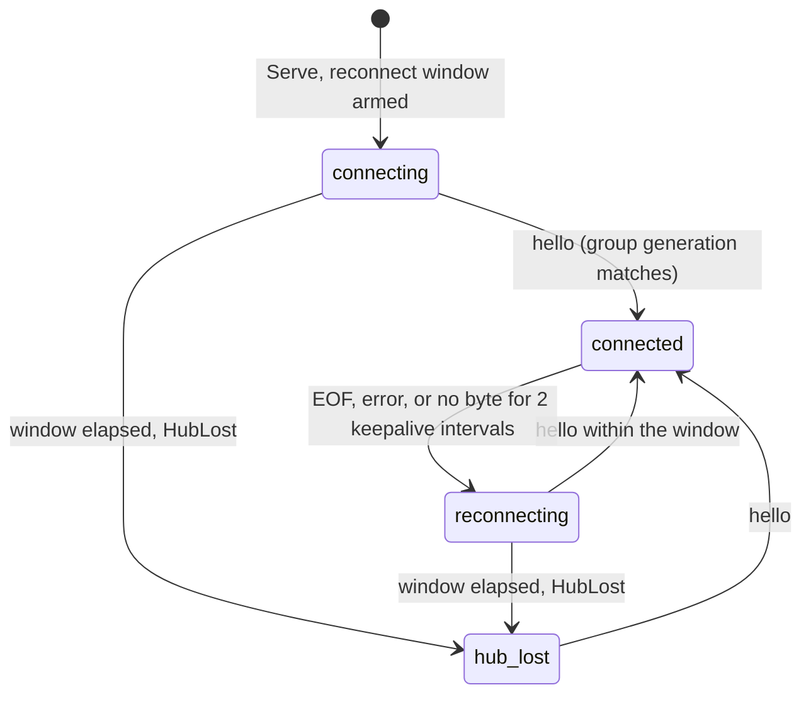

# A10 report: adapter server

Branch `a2a-a10`, based on `3850c09` (tip of `a2a` after A9 and A12; the
branch started at `6fdb667` and was fast-forwarded before the first commit).

## Summary

- `internal/a2aagent/server`: `Server` implements `a2aagent.Server`. `Serve`
  starts `Executor.Run` first (A8 start order), then the hub control
  connection, the ctl socket and the HTTP server on IPv4
  (`tcp4`, `0.0.0.0:<adapter port>`), and stops all of them when the context
  ends. The server takes the table and the executor as interfaces, so tests
  use the real A8 executor with `fakedriver` and a recording fake executor.
- `server.LoadConfig` implements the `a2aagent.LoadConfig` contract for both
  roles (see CR-A10-1: the stub lives in `agent.go`, which A10 may not edit).
- `cmd/enclave-a2a-agent/serve.go`: loads the config, builds the Claude driver
  from the a2a block in the environment (CR-A10-5), runs `CheckVersion`
  before anything starts, opens the table, creates the executor with the
  fixed 30 s heartbeat, and serves until SIGTERM or SIGINT.
- `cmd/enclave-a2a-agent/ctl.go`: reads one `a2a.CtlRequest` from stdin,
  forwards it to the running adapter over a unix socket and prints the
  `a2a.CtlResponse`.
- No new dependencies. A10's packages import only `internal/a2a`,
  `internal/a2aagent`, its subpackages, `internal/buildinfo` and
  `internal/tools` (for the A9 driver's spec type). `internal/model` reaches
  the binary through `contexttable` (util, logx) and the driver (tools), not
  through A10 code; relevant for the A14 image variant hash.

## Request pipeline

Every `POST /` goes through these checks in order. Each refusal is HTTP 200
with a JSON-RPC error body (interfaces.md section 11).

1. `Authorization: Bearer <outbound token>`, constant time: else `-31004`
   `UNAUTHENTICATED`, id `null` (nothing of the body is parsed).
2. Body bound (`ENCLAVE_A2A_MAX_REQUEST_BYTES`, default 1 MiB): else `-31018`
   `REQUEST_TOO_LARGE`.
3. `a2a.DecodeRequest`: `-32700` or `-32600`.
4. `a2a.CheckVersion`: `-32009`; `a2a.CheckExtensions`: `-32008`.
5. Principal headers from the hub. Missing group, group generation, member,
   role, generation or epoch: `-31004`. Group or group generation not this
   adapter's, malformed generation, or an orchestrator generation the hub
   reported as superseded: `-31017` `GENERATION_UNKNOWN` (see CR-A10-4).
   Role `worker`: `-31005` `ROLE_FORBIDDEN`. Role `host` must be member
   `_host`; member `_host` must have role `host`.
6. Dispatch.

## Method and error table

| Method | Result | Errors |
| --- | --- | --- |
| `SendMessage` | `{"task": Task}` after the terminal state; with `returnImmediately` right after admission | see send checks below; a dropped caller never cancels |
| `SendStreamingMessage` | SSE: `{"task": Task}` first, then `statusUpdate` and `artifactUpdate` events, terminal `statusUpdate` with metadata, then close | same as send |
| `GetTask` | `Task` | `-32602` no id; `-32001` unknown or bound to another principal |
| `CancelTask` | `Task` (canceled and confirmed, or failed `cancel` and unconfirmed, or canceled `not-applicable` when queued) | `-32602`, `-32001`, `-32002` on a terminal task |
| `SubscribeToTask` | SSE, first event the current `Task`, then as for streaming send | `-32602`, `-32001`, `-32004` on a terminal task |
| `ListTasks` | | `-32004` |
| `GetExtendedAgentCard` | | `-32007` |
| `Create/Get/List/DeleteTaskPushNotificationConfig` | | `-32003` |
| anything else | | `-32601` |

Send checks, in order: `-32602` (fixed text, never the Go decoder message)
for ill-typed params, `message.Validate` failures, a role other than
`ROLE_USER`, invalid enclave metadata, and a client-supplied `principal` on
the message or on the request; `-32005` for a non-text part; `-32001` for a
`message.taskId` the principal does not own, `-32602` for one it owns (v1 has
no interrupted tasks to continue); then the epoch wait (below), then
`Admit`, which raises `-31010`..`-31016` and `-31012`/`-31013` for dedupe.

Error data: codes in `-31099..-31000` carry one `ErrorInfo` with domain
`enclave.eclipse.dev`; every other code (A2A range, JSON-RPC standard) is
sent without `data`, including table refusals such as `-32001`, whose
`ErrorInfo` the server strips. Unexpected errors are `-32603` "Internal
error" and are logged, never sent.

Metadata (confirmed for A11):

- The first SSE event of `SendStreamingMessage` and of `SubscribeToTask`
  is `{"task": Task}`. The client can always take the task ID from it.
- `termination`, `reason` and `queuePosition` (while submitted, 0 means
  "starts now", the running task counts) are under
  `metadata["https://enclave.eclipse.dev/a2a/ext/v1"]` on `Task.metadata`;
  `termination` and `reason` also ride the terminal
  `TaskStatusUpdateEvent.metadata`.
- The final text is the artifact `result` (an `artifactUpdate` before the
  terminal status, and `Task.artifacts` on `GetTask`, `CancelTask` and the
  blocking send). The adapter sets no `status.message`.
- The send response's `Task.history` holds the stored message, whose
  `metadata[ExtensionURI]` carries the adapter-written `principal` and the
  `retry` flag. Later `GetTask` calls have no history: the text is not
  persisted (CR-A8-2).

Content hash for dedupe: `sha256:` of the JSON `{"contextId", "parts"}` with
the text parts in order. Metadata is excluded so that a flagged retry hashes
like its original. The harness gets the text parts joined with `\n`; the
executor prepends the provenance line.

Card (`GET /.well-known/agent-card.json`, outbound token required, else
HTTP 401; `Cache-Control: max-age=0`): name is the member name; description
is `ENCLAVE_A2A_DESCRIPTION` or `enclave worker <name>`;
`supportedInterfaces[0].url` is the hub-facing
`http://<hub host>:<hub port>/peers/<name>`, because the hub never rewrites
bodies; `streaming: true`; push and extended card absent; one extension
`{uri: ExtensionURI, required: true, params: {queueDepth}}`;
`securitySchemes.bearer.httpAuthSecurityScheme.scheme = "Bearer"` with the
matching requirement; text/plain modes; skills from the a2a block, or one
generic skill since the spec requires at least one.

## Control stream state machine

The adapter connects to `http://<hub host>:<hub port>/_enclave/control`
over IPv4 with `Authorization: Bearer <inbound token>` and the protocol
headers. One dispatcher goroutine applies hello, orchestrator and loss
events in arrival order, so a slow `EpochChanged` cannot reorder them.

- **hello**: must be the first event; a different group generation or a
  malformed epoch drops the connection (status unchanged, retried with
  backoff 100 ms doubling to 5 s). A hello with an epoch other than the last
  one clears the confirmed epoch, calls `EpochChanged(epoch)` (old-epoch
  running and queued work ends with `epoch-changed`), then publishes the new
  epoch. A hello with the same epoch only re-confirms it.
- **Admission and the epoch**: a send is admitted only when its
  `X-Enclave-A2A-Epoch` equals the epoch the control stream confirmed. The
  send waits up to 30 s (`Options.EpochWait`) for that, which covers a hub
  restart race (request with the new epoch before the new hello), then fails
  with `-32603` and admits nothing (CR-A10-6). This keeps the executor from
  failing a just-admitted task at dequeue because its epoch filter still has
  the old value. `GetTask`, `CancelTask` and `SubscribeToTask` do not depend
  on the epoch (P10 epoch independence).
- **Keepalive**: any byte on the stream, comment or event, resets the timer.
  No byte for 2 intervals (15 s each, `Options.KeepaliveInterval` in tests)
  closes the connection and counts as a loss.
- **Reconnect window** (`ENCLAVE_A2A_RECONNECT_WINDOW`, default 60 s): armed
  at start and on every loss, disarmed by a hello. When it elapses the
  adapter clears the confirmed epoch and calls `HubLost` (running and queued
  work fails with `hub-lost`). It also fires when the hub is never reached
  after start; nothing can have been admitted then, so it ends nothing.
- **orchestrator events**: `connected: false` arms a per-orchestrator timer
  for the reconnect window; `connected: true` disarms it. When it fires, the
  adapter calls `Depart(principal, authoritative=false)`: persisted
  `suspected` admission stop and queued work discarded with
  `orchestrator-lost`; running work continues (P13). A later `connected:
  true` does not lift the stop; only `ctl release-admission` does. An event
  with a new generation for the same member replaces the tracked generation,
  and requests with the old one get `-31017`.

## ctl operations

`enclave-a2a-agent ctl [op] < request.json`. The op comes from stdin JSON or
the single argument; both given and different is a usage error. The command
connects to the adapter's socket `/tmp/enclave-a2a-agent/ctl.sock` (0600,
directory 0700, replaced at adapter start; CR-A10-2), sends the request,
prints the `CtlResponse` on stdout and exits 0 when `ok` is true, 1 when it
is false or the adapter is unreachable (the response then carries the
error), 2 on usage errors. Nothing is read from argv except the op. The
principal must belong to this group and group generation (empty group
fields are accepted), carry a valid generation, and have role
`orchestrator` or `host`.

| Op | Effect | Response |
| --- | --- | --- |
| `depart` | `Executor.Depart(principal, authoritative)`; also stops suspicion tracking for that principal | `ok`, `departure` (the three-fact ack from the executor, also on error when partial) |
| `release-admission` | `Table.ReleaseAdmission(principal)` | `ok` |
| `release-quarantine` | `DescendantsAlive`; when false, `SetQuarantine(nil)` | `descendantsAlive`, `quarantined` after the call; `ok` only when the quarantine is gone, else `error: descendants still alive; quarantine kept` |
| `status` | none | `quarantined`, `descendantsAlive`, `ok` |

Quarantine reporting therefore has three channels: `restrictions.json`
(written by the executor, read by `ps`), `ctl status`, and `-31015` on
every send while quarantined.

## Change requests

- **CR-A10-1** (section 8, `a2aagent.LoadConfig`). Interfaces.md assigns
  `LoadConfig` to A10, but its stub is in `internal/a2aagent/agent.go`,
  which the A10 brief forbids, and the body cannot live in a subpackage that
  `agent.go` calls (import cycle through `a2aagent.Config`). Implemented as
  `server.LoadConfig` in `internal/a2aagent/server/config.go`, which depends
  only on `internal/a2a` and the standard library. Proposed: move that file
  into package `a2aagent` (drop the `a2aagent.` qualifiers), delete the stub,
  and switch `serve.go` and the tests to `a2aagent.LoadConfig`. A11 calls
  `a2aagent.LoadConfig` and is non-functional until this is done, so it
  should land with the A10 merge. The function covers A11's requirements:
  both roles require group, group generation, member, member generation,
  hub host and port, and the inbound token; workers also require the
  outbound token, adapter port and table directory; `TableDir` is accepted
  for orchestrators (CR-A11-1). Absent bounds stay zero.
- **CR-A10-2** (section 11, host access). The ctl path from the host to the
  running adapter is unspecified. Implemented as a unix socket at the fixed
  container path `/tmp/enclave-a2a-agent/ctl.sock`, one JSON request and one
  JSON response per connection. Proposed: record the path in section 11.
  A7's `SignalWorker` must exec `ctl` as the session user (the socket is
  0600). Consequence under CR-W0B-3: the worker's own harness, same uid,
  can reach the socket and release its own quarantine or admission stops.
  That is the accepted "worker trusted about itself" position, but the docs
  (D6) should state it.
- **CR-A10-3** (`internal/a2a/wire.go`). The four push-config method names
  are spec-derived but not in `wire.go`; the server keeps them as unexported
  constants. Proposed: A1 or the coordinator adds `MethodCreateTaskPushNotificationConfig`,
  `MethodGetTaskPushNotificationConfig`, `MethodListTaskPushNotificationConfigs`,
  `MethodDeleteTaskPushNotificationConfig`.
- **CR-A10-4** (section 11, "principal generation unknown to it"). The
  adapter has no source of current member generations: the env carries only
  its own, and the control stream carries only the orchestrators it reports.
  The host principal's generation in particular never reaches the worker.
  Implemented today: group and group generation must match, the generation
  must be well formed, and an orchestrator generation the hub reported as
  replaced is refused. Proposed: the hub adds `principals: [{member, role,
  generation}]` (orchestrators and the host principal of the applied
  revision) to `ControlHello`, and sends a `membership` event with the same
  list after every applied revision. The adapter would then refuse any
  generation outside the list. Stopped on this point until decided.
- **CR-A10-5** (section 6, env). Serve mode needs the tool's `sandbox.a2a`
  block and the yolo flag inside the container, and no variable exists
  (A14 and I1 have not landed). Proposed, implemented in `serve.go` as local
  constants: `ENCLAVE_A2A_HARNESS`, the block as JSON (I1 marshals
  `tools.RequireA2A(profile)`), and `ENCLAVE_A2A_HARNESS_EXTRA_ARGS`, a JSON
  array placed after the harness command (I1 writes `[profile.YoloFlag]`
  for yolo sessions). Unknown fields in the block are refused. Without
  extra args serve logs that the worker runs without bypassed permissions
  and continues; I1 rejects a non-yolo worker earlier. The executor strips
  both from the harness environment with the rest of `ENCLAVE_A2A_*`.
  Proposed: add both names to `internal/a2a/enclave.go` and section 6.
- **CR-A10-6** (section 11, errors). A send whose epoch the control stream
  has not confirmed is refused before admission with plain `-32603`. The
  refusal is retry-safe (nothing admitted), but the client cannot tell that
  from `-32603`. Proposed: `-31019` "epoch unconfirmed", reason
  `EPOCH_UNCONFIRMED`, raised by the adapter.

## Decisions inside the contract

- The card requires the outbound token too (P9: every request). A3 must
  forward card fetches with it.
- `X-Enclave-A2A-Epoch` is required on every request, like the other
  principal headers; `X-Enclave-A2A-Revision` is read by no code.
- Text parts are joined with a newline for the harness.
- A2A streams get a keepalive comment every 15 s; readers ignore comments.
- If a subscription closes without a terminal event, the stream sends the
  recorded terminal status, or a final `-32603` error event if the task is
  still active, then closes.
- The orchestrator state after a control reconnect is whatever the last
  event said; the adapter does not start suspicion timers on its own after
  a reconnect. See the A3 note below.

## Test coverage

`internal/a2aagent/server` (all files except `config_test.go` are
`//go:build linux`, since they run the A8 executor):

| Area | Tests |
| --- | --- |
| Config, both roles, CR-A11-1, every rejection | `TestLoadConfigWorker`, `TestLoadConfigOrchestratorNeedsNoWorkerFields`, `TestLoadConfigRejects` |
| Card: token, URL, extension required with `queueDepth`, bearer scheme, cache header | `TestCard` |
| Token, version, extension, principal headers, group generation, malformed generation, worker role, host member, size bound, parse error, `null` id, unknown method, `ListTasks`, extended card, push, unknown task for get, cancel and subscribe, no `data` on A2A codes | `TestRefusalsBeforeDispatch` |
| Send params: decoder text never leaked, no message ID, no parts, agent role, data part, client principal on message and request, bad metadata, unknown task ID, nothing admitted | `TestSendValidation` |
| Streaming send end to end (fake driver): task first, queue position, stored principal, provenance in the harness prompt, artifact, terminal metadata; `GetTask`; subscribe and cancel on terminal; foreign principal; flagged retry; unflagged reuse; reuse with other content; blocking send in an existing context; foreign context; `returnImmediately` | `TestStreamingSendCompletes` |
| Cancel running (confirmed), live streams end canceled, subscribe mid-run, dropped stream does not cancel, cancel twice | `TestCancelRunningTask` |
| Queue position 1 while another task runs; cancel of a queued task | `TestQueuePositionWhileSubmitted` |
| Control auth and first handshake | `TestControlHandshake` |
| Hello from another group generation | `TestHelloFromAnotherGroupGenerationIsRefused` |
| Send waits for the epoch, refuses without it, refuses a foreign epoch | `TestSendWaitsForTheControlEpoch` |
| Epoch change ends running (confirmed) and queued (not-applicable) work; old epoch refused, new admitted | `TestEpochChangeEndsOldEpochWork` |
| Keepalive loss after 2 intervals, reconnect, no work ended | `TestKeepaliveLossReconnects` |
| Reconnect window elapsed: hub-lost, confirmed; sends refused until the hub returns | `TestHubLostAfterReconnectWindow` |
| Suspected departure from orchestrator events; flapping orchestrator untouched; reconnect does not lift the stop | `TestSuspectedOrchestratorDeparture` |
| Superseded orchestrator generation refused | `TestSupersededOrchestratorGeneration` |
| ctl status, authoritative depart with the full ack, admission stop, host work untouched, release-admission, quarantine refusal, release-quarantine with and without live descendants | `TestCtlOperations` |
| ctl refusals and a malformed request | `TestCtlRefusals` |
| ctl depart passes `authoritative=false` | `TestCtlSuspectedDepartureViaFakeExecutor` |

`cmd/enclave-a2a-agent`: `TestCtl` (op from stdin or argv, contradictions,
unknown op, not JSON, extra args, not OK is exit 1, adapter not running),
`TestServeRefusesBeforeStarting` (empty env, orchestrator role, no a2a
block, arguments), `TestNewDriverFromHarnessEnv` (Claude driver from the
block, extra args in argv, skills, warning without extra args, refusals),
`TestTranscriptRoot`.

Timings on this host: server suite 3.5 s; `go test -race -count=3` over the
server and cmd packages 22 s, no failures.

## Integration notes

- **A9** (merged): `serve.go` builds `claude.New(spec, claude.Options{ExtraArgs,
  Log})` and runs `CheckVersion` before the table and executor exist, so it
  never overlaps a task. Card skills come from `spec.skills`.
- **A14**: the entrypoint runs `enclave-a2a-agent serve` as the session's main
  process for `ENCLAVE_A2A_ROLE=worker`; its stderr is the adapter log.
  `/tmp` must be writable for the ctl socket. Exit 1 with a message means a
  refused start (config, missing a2a block, version pin, table).
- **I1**: write `ENCLAVE_A2A_HARNESS` and `ENCLAVE_A2A_HARNESS_EXTRA_ARGS`
  (CR-A10-5) and `ENCLAVE_A2A_TABLE_DIR` as
  `<tool configDir>/a2a/<memberGeneration>` (the transcript root is derived
  from that shape; another shape disables transcript deletion). Interpret
  `release-quarantine` by `ok` and `descendantsAlive`, and accept
  `termination: not-applicable` in departure acks (A8).
- **A3** (hub): send `hello` first, keepalive comments every 15 s; send the
  current state of every orchestrator right after each `hello`, not only on
  changes, or a hub restart can hide an orchestrator that left meanwhile;
  forward card fetches with the outbound token; the forwarded
  `X-Enclave-A2A-Epoch` must be the epoch of the hub's control `hello`.
- **A7**: `SignalWorker` execs `enclave-a2a-agent ctl` as the session user
  with the request on stdin.
- **A11**: covered above (LoadConfig, first event, metadata, artifacts).

## Open items

- CR-A10-1 blocks A11 at runtime until `LoadConfig` moves into `a2aagent`.
- CR-A10-4 (generation source) is only partly implemented.
- Truncated results: the executor sets `truncated` but no marker reaches the
  wire. Proposal 17 says "truncated with marker"; A8b could append one to
  the text, or the extension could gain a field.
- Message history is not persisted, so `GetTask` returns no history.
- The ctl socket is reachable by the worker's own harness (CR-A10-2, Q1).

## Gates

- `make build`: pass.
- `make test`: pass.
- `make lint-changed`: pass (go vet, golangci-lint 0 issues, gosec clean
  after two annotated taint findings: the hub URL from the host-written env
  (G704) and the JSON-RPC body written as `application/json` (G705)).
- `make check-license-headers`: pass (753 files).
- `GOOS=darwin` and `GOOS=windows` `go vet` on the server and the agent
  command: pass.
- `make generate` not run (no option or extension code changed).
