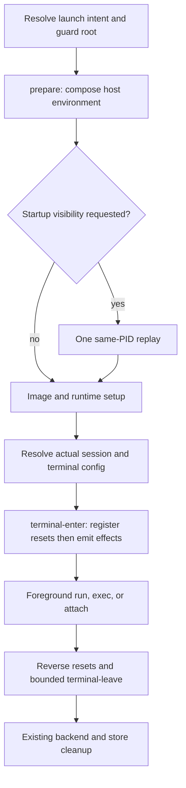

# Host lifecycle hooks

Host hooks are **opt-in host executables**, not sandbox startup scripts. They
prepare the CLI's host environment or mark a terminal occupied by a session.
Installing a package, selecting a container feature, or setting `defaultEnabled`
does not grant permission to execute hooks. No hook success implies agent readiness.

## Install and enable

Tools and features may contribute `hooks/host/manifest.json` and phase executables:

```text
extensions/features/example/
  spec.yaml
  README.md
  hooks/host/
    manifest.json
    prepare
    terminal-enter
    provider.py
```

User providers instead live at `~/.config/enclave/hooks/host/<name>/`, with the
manifest directly in that directory. Paths use the platform config root (see
[configuration](../configuration.md)); macOS uses the Apple layout, not XDG.
Provider IDs are `user:<name>`, `feature:<name>`, `tool:<name>`, and the reserved
`builtin:session-tint`. Namespaces never shadow each other. Tool providers only
apply to the selected tool; feature providers do not require container selection.
Checkout extensions, embedded assets and `ENCLAVE_HOME` are not executable hook
sources. User-installed extensions and the user hooks root are the only sources.

```json
{"schemaVersion":"1","phases":{"prepare":"prepare","terminal-enter":"terminal-enter"}}
```

Each declared handler must be an executable regular file at a relative path
inside the provider directory, including after symlink resolution. Broken,
looping, absolute and escaping paths are rejected. Helpers are not independently
discovered. Unknown manifest versions/phases disable the provider. Unsupported
`hooks/` children warn. Installation rejects invalid manifests; inventory reports
problems without executing anything.

Configure activation independently of `features`:

```json
{
  "host_hooks": {
    "feature:herdr": {"enabled": true},
    "feature:session-tint": {"enabled": true, "settings": {"color": "#2a0f12"}},
    "builtin:session-tint": {"enabled": false}
  }
}
```

Global, outside-worktree project config, then merged per-tool overrides layer by
provider ID. Omitted entry fields inherit. Explicit `enabled: false` disables;
`order` is an integer (default 100). A supplied `settings` object **replaces** the
entire lower object; `{}` clears settings. An empty `host_hooks` map contributes
no overrides. Disable individual inherited IDs explicitly. Core validates IDs
and entry types; providers validate settings. `enclave config` reports effective
activation separately from container feature enablement, including per-field
source rows for merged entries. Installing/enabling a host-only integration does
not build an image. Slim, explicit images and devcontainer feature defaults do
not suppress enabled host integrations.

## Phases and ownership



`prepare` runs for run/continue/resume/shell and exec (including default-shell
exec), after tool/backend/action resolution and IDE auto-backgrounding, before
image builds, stores, networking and start locks. Session commands use shell-style
intent. Background starts may prepare but never enter a terminal scope. Attach
only runs terminal phases. Help, completion, inventory, config, installation,
updates, cleanup, status, ps, stop, and ordinary host-command dispatch run no hooks.
A host command launching a session may enter the normal lifecycle.

Prepare settings describe invocation intent. Exec/attach terminal settings use the
**actual target's tool and project**, falling back to invocation configuration for
older sessions missing metadata. A target config change does not run prepare again.
Terminal phases are skipped entirely unless session stdout is a TTY. The start
lock is still released by backend `OnStarted`, not held for the session lifetime.

## Executable protocol v1

Handlers run directly (OS shebang resolution), with the provider directory as
cwd and one JSON request on stdin. Agent stdin is never passed through. Protocol
stdout is captured, while bounded diagnostics go to CLI stderr with provider ID.
Handlers inherit the host environment except internal Enclave replay/recursion
variables. Core sets a child-only recursion marker, preventing nested Enclave
sessions launched by a hook from invoking another hook chain.

```json
{
  "schemaVersion": "1", "phase": "prepare", "invocationId": "opaque",
  "providerId": "feature:herdr", "action": "run", "backend": "docker",
  "background": false, "shell": false,
  "tool": {"name": "claude", "entrypoint": ["claude"]},
  "command": {"argv": ["claude", "literal argument"], "explicit": false},
  "project": {"path": "/work/project", "hash": "opaque"}, "session": null,
  "terminal": {"stdoutIsTTY": true, "colorSuppressed": false}, "settings": {}
}
```

The early command is launch intent, not final Docker/tmux wrapper argv.
`command.explicit` distinguishes an explicit exec command from default-shell exec.
Terminal requests also include `session: {"name": "...", "id": "..."}` and a fresh
`attachmentId`. Leave receives enter's bounded `state` and an `outcome` object:
`status` is `completed`, `failed`, `interrupted`, or `unknown`, plus `exitCode` when
known. Successful attach currently reports `unknown` because the backend does not
distinguish detach from completion. No credentials, full host environment, stores,
backend requests or Docker labels appear in the JSON.

Successful empty stdout is a no-op. Otherwise return exactly one JSON object with
`schemaVersion: "1"`; trailing non-whitespace or wrongly typed known fields fail.
Unknown response fields are ignored for additive v1 evolution. Hook failures warn
and continue, never replacing the backend/tool exit code.

### Prepare response

```json
{
  "schemaVersion": "1",
  "hostEnvironment": {"setIfAbsent": {"HERDR_AGENT": "claude"}},
  "restartHostProcess": true
}
```

`hostEnvironment` supports `set`, `setIfAbsent`, and `unset` (array of names).
Overlapping operations, invalid names, NULs and Enclave-owned `ENCLAVE_*` writes
reject the entire response. Existing empty values count as present. Providers run
in `(order, canonical ID)` order and see earlier accepted changes. Conflicting
explicit writes keep the earlier response and discard the entire later response;
`setIfAbsent` finding an existing value is simply a no-op.

Core collects a deduplicated candidate environment before applying it. Replay is
valid only with an effective change, and at most one replay occurs for the entire
phase. Unix `execve` preserves PID, original argument boundaries and unread stdin;
a compact PID-bound versioned record retains tool/backend choices and their source
semantics without serializing profiles or credentials. Prepare and setup prompts
are not repeated even if saving defaults failed. Replay failure warns and continues
once with the original environment. Hooks cannot choose replay argv/executable.
The Windows binary remains a WSL launcher; hooks/replay execute in Linux.

Hook-added environment and settings are **not automatically forwarded** into the
container, auth stores or persisted environment. Explicit `--pass-env` remains an
independent user choice. Interactive prompt delays and an upstream acquisition
window cannot be eliminated by replay.

### Terminal response

```json
{
  "schemaVersion": "1",
  "terminalEffects": [{"resource": "background", "enter": "\u001b]11;#2a0f12\u0007", "leave": "\u001b]111\u0007"}],
  "state": {}
}
```

Core validates the complete response, registers idempotent resets, then writes
enter bytes to session stdout. Later claims of the same resource warn and are
skipped. Stored resets run in reverse order even if another enter fails or the
provider disappears. Optional `terminal-leave` executes only after successful enter,
with its state; failed/missing leave never prevents stored resets. Prepare cannot
emit terminal effects; terminal phases cannot modify the environment or replay;
leave cannot add terminal effects. An enter executable that fails must undo its
own partial nonterminal side effects.

Core owns signal cleanup; providers should return reset bytes, not rely on leave
scripts for terminal restoration. Runtime-owned SIGINT/SIGTERM keep existing
cancellation/cleanup semantics. Ctrl-C handled by the attached agent does not reset
a still-live terminal scope. Other intercepted termination restores stored resets
before retaining signal semantics. SIGKILL cannot be cleaned up.

### Bounds

| Limit | v1 |
| --- | --- |
| Request / response | 64 KiB each (oversize requests rejected, never truncated) |
| Diagnostics | 16 KiB per execution |
| Terminal sequence / state object | 4 KiB each |
| Prepare | 2 s/provider, 5 s/phase |
| Enter | 500 ms/provider, 2 s/phase |
| Leave | 500 ms/provider, 1 s/phase |

Unix process-group cancellation kills helpers and bounds inherited-pipe draining.
Leave uses a fresh bounded context even after runtime cancellation. These are
implementation constants, not configuration knobs.

## Tint compatibility and examples

Existing valid nonempty `session_tint` resolves to defaults for
`builtin:session-tint`, including color suppression and per-project/per-tool
precedence. Explicit `host_hooks` fields override those defaults; config is never
rewritten. When migrating to external tint, explicitly disable the built-in as in
the example above. Both providers claim `background`, so accidental double
enablement cannot emit competing effects.

Independently installable Python 3 reference packages live under
[`examples/host-hooks/features/`](../../examples/host-hooks/features/), outside
built-in assets. See [Herdr](../../examples/host-hooks/features/herdr/README.md),
[tint](../../examples/host-hooks/features/session-tint/README.md), and the
[terminal-title demonstrator](../../examples/host-hooks/features/session-title/README.md).
They require no Python in core, no automatic host package installation, and no
image rebuild.

Add/update/list/remove retain their version-1 envelopes with optional
`hostHooks: [{"id":"feature:herdr","phases":["prepare"]}]`. Inventory warnings
include malformed declarations. Updates show phases and handler/content changes;
whole-tree integrity still detects local edits. `hooks/` never reaches a container
context or image hash. Removal leaves config untouched: remove the provider's
`host_hooks` entry to clear dangling-provider warnings. Host commands remain manual
verbs and keep their existing discovery/precedence semantics.
