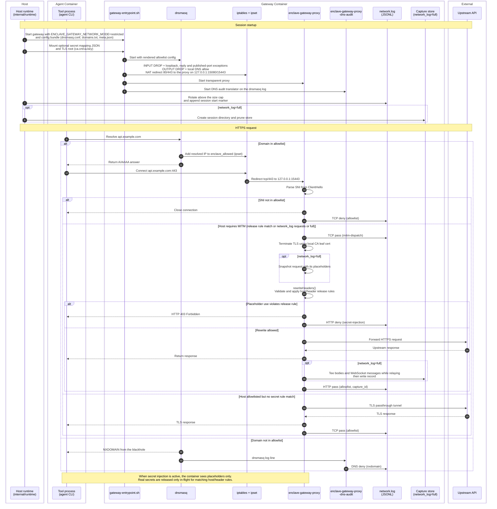
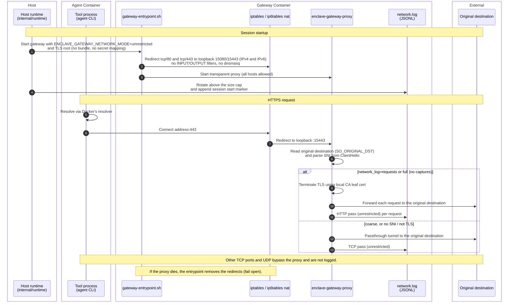

# Network request flow

How a restricted session handles an outbound request, and how the observing
gateway of an unrestricted session logs it ([Networking](../networking.md)).

## Diagram

## Flow summary

1. The host writes a gateway bundle (`dnsmasq.conf`, `domains.txt`,
   `meta.json`) and starts the sidecar.
2. `gateway-entrypoint.sh` sets a fail-closed firewall (`INPUT DROP`,
   `OUTPUT DROP`; inbound only loopback, established or related replies, and
   published ports), starts `dnsmasq`, and redirects outbound `tcp/80` and
   `tcp/443` to `enclave-gateway-proxy`.
3. Allowlisted domains resolve and populate the `enclave_allowed` ipset; others
   fail. Traffic to ports 80 and 443 goes to the proxy, which re-checks the
   allowlist against the `Host` header or SNI and connects upstream only to
   ipset addresses. Other ports reach ipset addresses directly, without the
   proxy or a log event.
4. It terminates TLS for hosts with a credential HTTP release rule
   (`network.serviceAuth`), and for all allowlisted HTTPS with
   `network_log=requests` or `full`.
5. In inspected requests, a registered placeholder is replaced only in the
   rule's header, on HTTPS to its declared hosts; other placeholder-bearing
   headers get HTTP 403. Upgraded connections (WebSocket) get this on the
   handshake and are then relayed unchanged.
6. Events go to `~/.local/state/enclave/projects/<hash>/<tool>/logs/network.log`
   (JSONL, read with `enclave network log`): the proxy writes `tcp` and `http`
   events, `enclave-gateway-proxy -dns-audit` translates dnsmasq's log into
   `dns` events (so DNS denials are logged even without the proxy), and the host
   adds a `session` marker. What each mode records is in
   [Coverage and granularity](../networking.md#coverage-and-granularity).

In `full` mode the proxy snapshots each relayed request before header release
and stores it with the response under `logs/capture/<session>/`; its `http`
event carries `capture_id`. WebSocket messages are also stored, with an open
record readable from the handshake. See [Full capture](../networking.md#full-capture).

## Properties and limits

- Real values of mapped credentials never appear in the tool container's
  environment. Release is header-based and covers only declared credentials
  with a release rule in the selected tool or enabled features; mediating
  file-based credentials is separate work.
- DNS, firewall and ipset, and proxy all check egress; reload and startup
  failures fail closed.
- The log is tagged by session and rotated at session start, never truncated
  mid-session. Logged paths omit the query string, so query-parameter
  credentials cannot leak into it. It records decisions, not traffic volume.
- In unrestricted mode the gateway only observes ports 80 and 443 and
  credential release is disabled; see [Unrestricted mode](#unrestricted-mode).
  With `--disable-gateway` there is no gateway.
- `--network-log=requests` enables request-level MITM logging in both modes.

## Unrestricted mode

An unrestricted session starts the same gateway image with
`ENCLAVE_GATEWAY_NETWORK_MODE=unrestricted` in its container environment and
the `enclave.gateway.mode=unrestricted` label, and without a config bundle.
The gateway takes its mode only from that environment, so no file on the host
can change it. It observes but never enforces. Sessions started with
`--disable-gateway` have no gateway and no network log.

- Nothing is denied: no inbound or outbound filters, IPv6 left as is, DNS
  stays with Docker's resolver, and the proxy dials the destination from the
  kernel's NAT record instead of re-resolving SNI or `Host`.
- Plaintext HTTP on port 80 gets an `http` event per request; non-HTTP bytes
  on port 80 and TLS without SNI on port 443 are tunnelled with a `tcp` event.
- No credential release: declared credentials are injected into the session
  with real values, as without a gateway.
- Proxy death removes the redirects and the gateway keeps running, so traffic
  continues unlogged; the gateway container stopping takes the session
  offline.
- OAuth callback ports (`oauthPorts`) reach a listener on `127.0.0.1` through
  a DNAT in `nat PREROUTING` and, for connections to the gateway's own IPv4
  address generated inside the namespace (rootless podman's port forwarder),
  in `nat OUTPUT`. If either rule cannot be added, a socat proxy on the
  container address takes over.
- `enclave network apply` skips these gateways; `enclave network status` shows
  them as `UNRESTRICTED`. A mode change needs a session restart.

## Related implementation

[`internal/runtime/network_manager.go`](../../internal/runtime/network_manager.go),
[`internal/runtime/auth_manager.go`](../../internal/runtime/auth_manager.go),
[`internal/gateway/bundle/bundle.go`](../../internal/gateway/bundle/bundle.go),
[`internal/gateway/mitm/proxy.go`](../../internal/gateway/mitm/proxy.go),
[`gateway-entrypoint.sh`](../../gateway-entrypoint.sh)

The unavailable internal native-auth path intercepts declared OAuth endpoints
before ordinary forwarding; see [store transactions](stores.md#internal-native-auth-exchanges).
