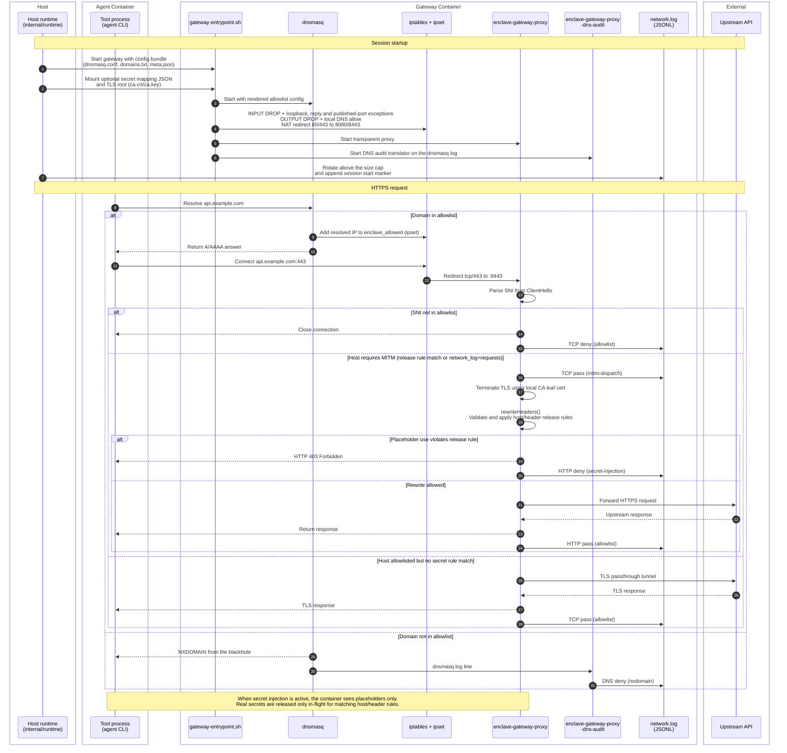

# Network request flow

How a restricted session handles an outbound request
([Networking](../networking.md)).

## Diagram

## Flow summary

1. The host writes a gateway bundle (`dnsmasq.conf`, `domains.txt`,
   `meta.json`) and starts the sidecar.
2. `gateway-entrypoint.sh` sets a fail-closed firewall (`INPUT DROP`,
   `OUTPUT DROP`; inbound only loopback, established or related replies, and
   published ports), starts `dnsmasq`, and redirects outbound `tcp/80` and
   `tcp/443` to `enclave-gateway-proxy`.
3. Allowlisted domains resolve and populate the `enclave_allowed` ipset; others
   fail. Traffic to ports 80 and 443 goes to the proxy, which re-checks the
   allowlist against the `Host` header or SNI and connects upstream only to
   ipset addresses. Other ports reach ipset addresses directly, without the
   proxy or a log event.
4. It terminates TLS for hosts with a credential HTTP release rule
   (`network.serviceAuth`), and for all allowlisted HTTPS with
   `network_log=requests`.
5. In inspected requests, a registered placeholder is replaced only in the
   rule's header, on HTTPS to its declared hosts; other placeholder-bearing
   headers get HTTP 403. Upgraded connections (WebSocket) get this on the
   handshake and are then relayed unchanged.
6. Events go to `~/.local/state/enclave/projects/<hash>/<tool>/logs/network.log`
   (JSONL, read with `enclave network log`): the proxy writes `tcp` and `http`
   events, `enclave-gateway-proxy -dns-audit` translates dnsmasq's log into
   `dns` events (so DNS denials are logged even without the proxy), and the host
   adds a `session` marker. What each mode records is in
   [Coverage and granularity](../networking.md#coverage-and-granularity).

## Properties and limits

- Real values of mapped credentials never appear in the tool container's
  environment. Release is header-based and covers only declared credentials
  with a release rule in the selected tool or enabled features; mediating
  file-based credentials is separate work.
- DNS, firewall and ipset, and proxy all check egress; reload and startup
  failures fail closed.
- The log is tagged by session and rotated at session start, never truncated
  mid-session. Logged paths omit the query string, so query-parameter
  credentials cannot leak into it. It records decisions, not traffic volume.
- Unrestricted mode bypasses the gateway and disables credential release.

## Related implementation

[`internal/runtime/network_manager.go`](../../internal/runtime/network_manager.go),
[`internal/runtime/auth_manager.go`](../../internal/runtime/auth_manager.go),
[`internal/gateway/bundle/bundle.go`](../../internal/gateway/bundle/bundle.go),
[`internal/gateway/mitm/proxy.go`](../../internal/gateway/mitm/proxy.go),
[`gateway-entrypoint.sh`](../../gateway-entrypoint.sh)
