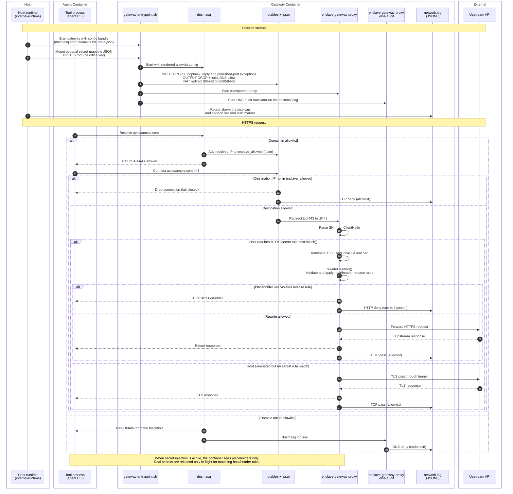
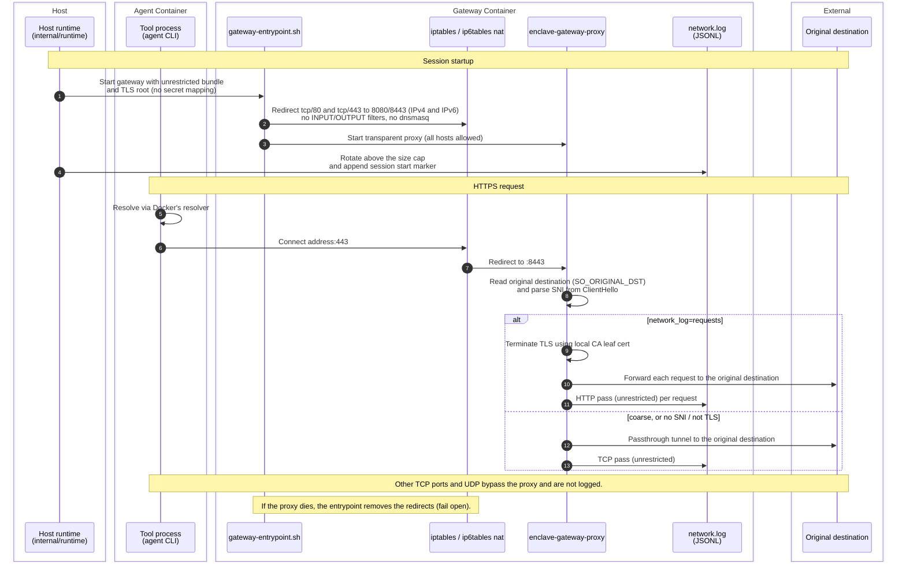

# Network Request Flow

This document describes how enclave handles outbound network requests in restricted mode, including DNS policy enforcement, proxying, and secret placeholder rewriting, and how the observing gateway of an unrestricted session logs them.

## Diagram

## Flow Summary

1. The host runtime writes a gateway config bundle (`dnsmasq.conf`, `domains.txt`, `meta.json`) and starts the sidecar.
2. `gateway-entrypoint.sh` applies a fail-closed firewall (`INPUT DROP` and `OUTPUT DROP`), starts `dnsmasq`, and redirects outbound `tcp/80` and `tcp/443` to `enclave-gateway-proxy`. Inbound traffic is limited to loopback, established/related replies, and published container ports.
3. DNS resolution goes through `dnsmasq`. Allowlisted domains resolve and populate the `enclave_allowed` `ipset`; non-allowlisted domains fail resolution.
4. TCP connections are gated by firewall rules and redirected to the proxy. The proxy checks host allowlist rules again using HTTP `Host` / TLS `SNI`.
5. For hosts that match declared secret `release.http` rules, or for all allowlisted HTTPS when `network_log=requests`, the proxy uses TLS MITM before forwarding upstream.
6. For inspected requests, a registered placeholder is substituted only in the rule's configured `header` on HTTPS requests to its declared `hosts`. Placeholder-bearing headers that do not satisfy the rule are rejected with HTTP 403.
7. `network_log=coarse` writes pass/deny events to `~/.local/state/enclave/projects/<hash>/<tool>/logs/network.log`: one `tcp` event per TLS connection at the ClientHello, and an `http` event per request for plaintext HTTP and for the MITM'd hosts of step 5. `network_log=requests` adds request-level HTTP/HTTPS audit events for every allowlisted host. The log is JSONL throughout: the proxy appends HTTP and TCP events, a separate `enclave-gateway-proxy -dns-audit` process translates dnsmasq's own log into `dns` events (so DNS denials are recorded even when the proxy is disabled), and the host appends a session marker at gateway start. Read it with `enclave network log`.

## Why This Works

- Real API key values for mapped secrets are never exposed inside the tool container environment.
- Egress checks happen at multiple layers (DNS allowlist, firewall/IP set, proxy host checks).
- Gateway reload/startup failures fail closed rather than silently allowing unrestricted egress.
- Host-side network logs preserve an auditable record of pass/deny decisions, tagged with the session that produced them and rotated at session start rather than truncated.
- Logged HTTP paths never include the query string, so credentials passed as query parameters cannot leak into the log.

## Scope and Limits

- In unrestricted mode (`--allow-all-network`, `allow_all_network`, or policy mode `unrestricted`), the gateway only observes ports 80 and 443 and HTTP secret release is disabled; see [Unrestricted Mode](#unrestricted-mode). With `--disable-gateway` there is no gateway.
- `--network-log=requests` enables request-level MITM logging in both modes.
- The log records decisions, not traffic volume. In `coarse` mode a reused TLS connection produces a single `tcp` event no matter how many requests it carries, and successful DNS lookups are never recorded, so an absence of events is not evidence of an absence of traffic. See [Coverage and granularity](../networking.md#coverage-and-granularity).
- Placeholder protection applies only to declared secrets with `release.http` in the selected tool profile or enabled feature manifests.
- Real secrets are released only in the rule's declared request header on HTTPS requests to its declared hosts. Inspected requests with registered placeholders in headers must satisfy these release rules.
- Current secret injection is header-based; file credential mediation is separate work.
- WebSocket and other protocol upgrades get secret release on the handshake headers; the upgraded connection is then relayed unchanged in both directions.

## Unrestricted Mode

An unrestricted session starts the same gateway image with an unrestricted bundle (`meta.json` records the mode, the gateway container carries the `enclave.gateway.mode=unrestricted` label, and the bundle lives in `gateway-config-unrestricted/`). The gateway observes but never enforces. Sessions started with `--disable-gateway` have no gateway and no network log.

- Nothing is denied: no inbound or outbound filters, IPv6 left as is, DNS stays with Docker's resolver, and the proxy dials the destination from the kernel's NAT record instead of re-resolving SNI or `Host`.
- Plaintext HTTP on port 80 gets an `http` event per request; non-HTTP bytes on port 80 and TLS without SNI on port 443 are tunnelled with a `tcp` event.
- No secret release: declared secrets are injected into the session with real values, as without a gateway.
- Proxy death removes the redirects and the gateway keeps running, so traffic continues unlogged; the gateway container stopping takes the session offline.
- `enclave network apply` skips these gateways; `enclave network status` shows them as `UNRESTRICTED`. A mode change needs a session restart.

## Related Implementation

- [`internal/runtime/network_manager.go`](../../internal/runtime/network_manager.go)
- [`internal/runtime/auth_manager.go`](../../internal/runtime/auth_manager.go)
- [`internal/gateway/bundle/bundle.go`](../../internal/gateway/bundle/bundle.go)
- [`internal/gateway/mitm/proxy.go`](../../internal/gateway/mitm/proxy.go)
- [`gateway-entrypoint.sh`](../../gateway-entrypoint.sh)
