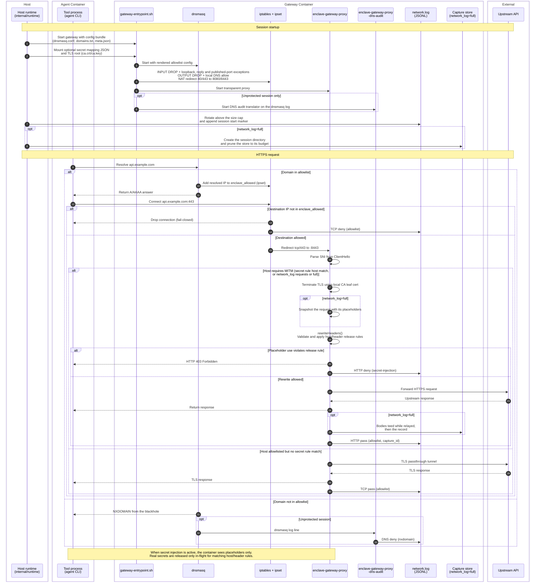
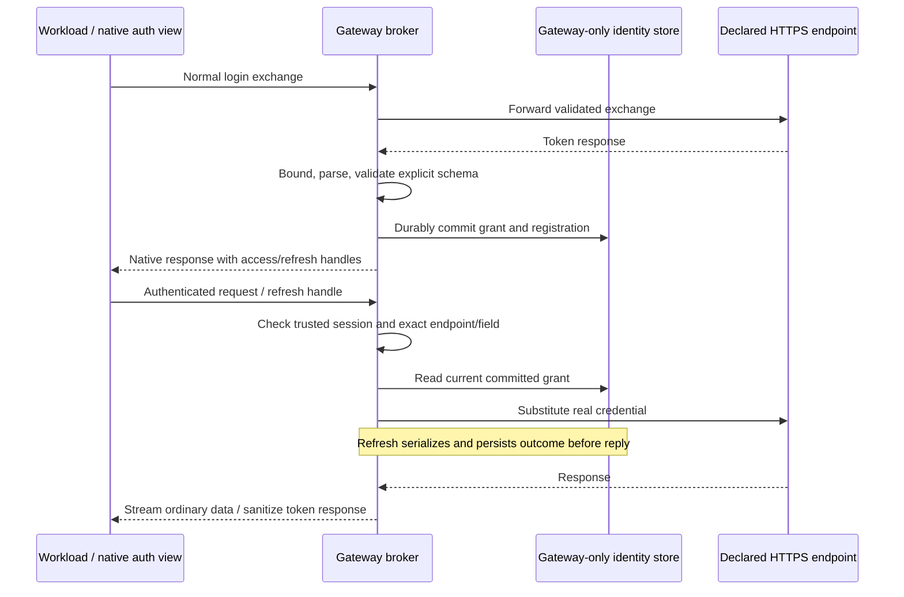

# Network Request Flow

This document describes gateway-mediated outbound requests: restricted destination
policy by default, and unrestricted IPv4 destinations with protected OAuth.
Unprotected unrestricted sessions continue to bypass the gateway.

## Restricted destination flow

## Flow Summary

1. The host runtime writes a gateway config bundle (`dnsmasq.conf`, `domains.txt`, `meta.json`) and starts the sidecar.
2. `gateway-entrypoint.sh` applies a fail-closed firewall (`INPUT DROP` and `OUTPUT DROP`), starts `dnsmasq`, and redirects outbound `tcp/80` and `tcp/443` to `enclave-gateway-proxy`. Inbound traffic is limited to loopback, established/related replies, and published container ports.
3. DNS resolution goes through `dnsmasq`. Allowlisted domains resolve and populate the `enclave_allowed` `ipset`; non-allowlisted domains fail resolution.
4. TCP connections are gated by firewall rules and redirected to the proxy. The proxy checks host allowlist rules again using HTTP `Host` / TLS `SNI`.
5. For hosts that match declared secret `release.http` rules, or for all allowlisted HTTPS when `network_log` is `requests` or `full`, the proxy uses TLS MITM before forwarding upstream.
6. If a known placeholder appears on plaintext HTTP, on a host outside that secret rule's `hosts`, or in a header other than that rule's declared header (matched case-insensitively), the proxy blocks the whole request with HTTP 403.
7. `network_log=coarse` writes pass/deny events to `~/.local/state/enclave/projects/<hash>/<tool>/logs/network.log`: one `tcp` event per TLS connection at the ClientHello, and an `http` event per request for plaintext HTTP and for the MITM'd hosts of step 5. `network_log=requests` adds request-level HTTP/HTTPS audit events for every allowlisted host. `network_log=full` also snapshots each relayed request before step 6 releases secrets into it and stores it, with the response, under `logs/capture/<session>/`; its `http` event carries the `capture_id`. The log is JSONL throughout: the proxy appends HTTP and TCP events, and the host appends a session marker at gateway start. In unprotected sessions, a separate `enclave-gateway-proxy -dns-audit` process translates dnsmasq's log into `dns` events, even when the proxy is disabled. Protected sessions disable raw DNS logging and this translator. Read it with `enclave network log`.

## Why This Works

- Real API key values for mapped secrets are never exposed inside the tool container environment.
- Egress checks happen at multiple layers (DNS allowlist, firewall/IP set, proxy host checks).
- Gateway reload/startup failures fail closed rather than silently allowing unrestricted egress.
- Host-side network logs preserve an auditable record of pass/deny decisions, tagged with the session that produced them and rotated at session start rather than truncated.
- Logged HTTP paths never include the query string, so credentials passed as query parameters cannot leak into the log.

## Scope and Limits

- Without `--protect-auth`, unrestricted mode (`--allow-all-network` or policy mode `unrestricted`) bypasses the gateway and disables HTTP secret release. Protected sessions retain mediation under both selectors; see below.
- `--network-log=requests` enables request-level MITM logging for permitted destinations whenever the gateway runs.
- `--network-log=full` adds stored HTTP exchanges and WebSocket messages whenever the gateway runs. See [Full capture](../networking.md#full-capture).
- The log records decisions, not traffic volume. In `coarse` mode a reused TLS connection produces a single `tcp` event no matter how many requests it carries, and successful DNS lookups are never recorded, so an absence of events is not evidence of an absence of traffic. See [Coverage and granularity](../networking.md#coverage-and-granularity).
- Placeholder protection applies only to declared secrets with `release.http` in the selected tool profile or enabled feature manifests.
- Real secrets are released only on HTTPS requests; plaintext HTTP requests carrying a placeholder are denied.
- Env-secret injection is restricted to declared headers. The opt-in OAuth adapter below separately mediates captured native-file credentials.
- Ordinary upstream responses are streamed without credential masking. A provider that reflects an approved auth header can expose its value, so matching a release rule does not remove trust in the provider.
- WebSocket and other protocol upgrades get secret release on the handshake headers; the upgraded connection is then relayed unchanged in both directions. Sessions with the protected OAuth broker drop upgrade requests to the hosts it mediates and reject their `101` responses, because the broker cannot inspect an upgraded stream. Handshakes to other hosts pass the broker's handle checks before the stream is relayed.

## Opt-in protected OAuth path

`--protect-auth` registers the Claude broker and the enabled built-in GitHub
feature adapter before login. Each gets a session-specific native auth view
containing handles. Normal login without that
option keeps the existing workload-readable credentials. The implemented opt-in
flow still needs the [pinned-client and container verification runs](oauth-broker-verification.md):

Capture must be installed before a grant exists, not inferred from the current
env-secret mapping snapshot. Only declared HTTPS origins, ports, methods, paths
and auth fields may resolve broker handles. The adapter rejects unknown token
response fields, unsupported encodings and unsafe errors/headers; it never
passes a raw token response through after a parsing or persistence failure.
Env-secret release separately enforces its declared host and header; it does
not gain the broker's endpoint-specific path and method restrictions.

The GitHub adapter keeps its real feature-auth files gateway-only, captures the
supported GitHub.com device-token response and releases credentials only through
its declared API and HTTPS Git authentication fields. It does not enable
Enterprise, PAT-paste bootstrap or other native-auth features. GitLab remains
env-secret based. See the [adapter limits and verification gates](oauth-broker-verification.md).

### Unrestricted destinations with mediation

With protected auth, either unrestricted selector keeps the same gateway
namespace, CA, broker mounts and selective MITM. DNS forwards every domain to
the configured upstream resolver. The IPv4 firewall permits arbitrary
destinations while still redirecting ports 80/443 through the proxy; only the
proxy UID bypasses interception. The proxy skips destination allowlists, not
credential release checks. IPv6 remains disabled, as in restricted gateways.

The OUTPUT chain's default remains DROP. The supervisor flushes permissive
rules on unexpected proxy/gateway failure, so this mode cannot silently turn
into a bypass. Ordinary upstream responses still stream promptly.

Same-mode bundle reload restarts the proxy process without replacing the
gateway or its handle registry. Active gateway metadata records both the mode
and its source. `network apply` preserves a session's `--allow-all-network`
override; policy-driven mode changes require a new session and are rejected
before writing the replacement bundle. The gateway also refuses mode switches
during reload. New logical sessions receive fresh handles.

Protected sessions disable raw dnsmasq query logging and the DNS audit
translator. Network logs therefore contain no DNS events for those sessions;
untrusted HTTP/TLS audit details are also redacted. This reduces diagnostic
coverage and does not turn logs into a safe recorder of OAuth exchanges.

## Related Implementation

- [`internal/runtime/network_manager.go`](../../internal/runtime/network_manager.go)
- [`internal/runtime/auth_manager.go`](../../internal/runtime/auth_manager.go)
- [`internal/gateway/bundle/bundle.go`](../../internal/gateway/bundle/bundle.go)
- [`internal/gateway/mitm/proxy.go`](../../internal/gateway/mitm/proxy.go)
- [`internal/gateway/oauthbroker/`](../../internal/gateway/oauthbroker/) (opt-in native-auth adapters)
- [`gateway-entrypoint.sh`](../../gateway-entrypoint.sh)
