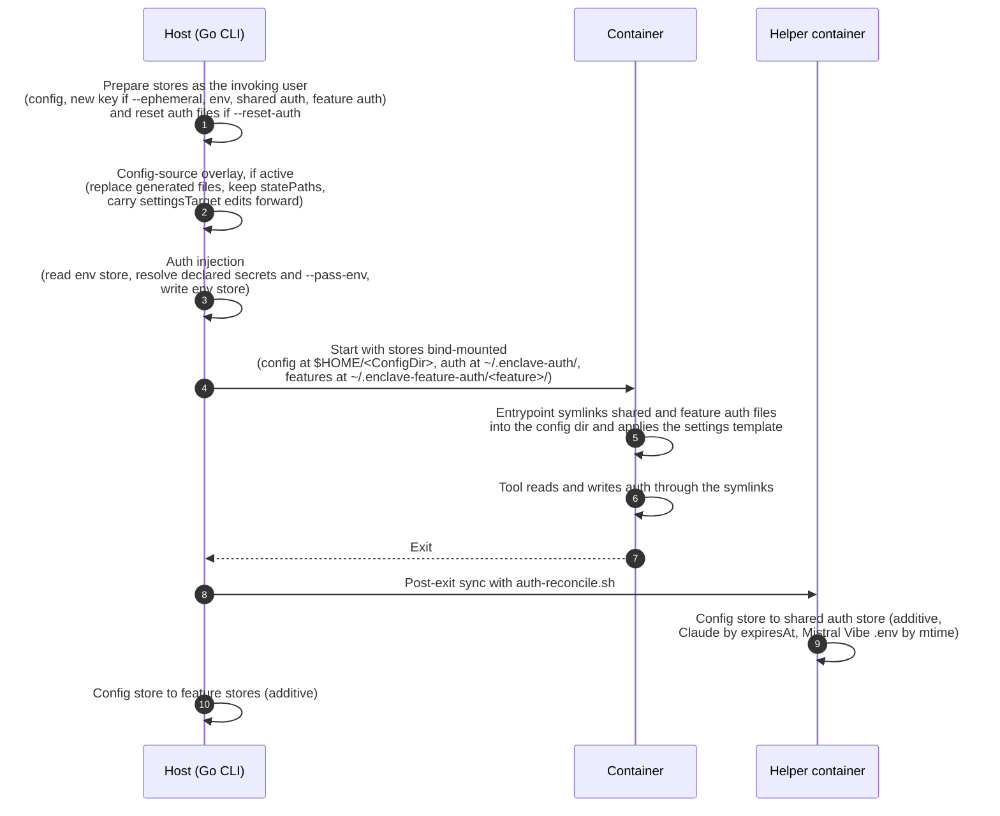

# Persistent stores and auth persistence

Internals of the host directories that keep tool configuration, agent memory,
secrets, and logins across sessions. User-level overviews:
[Sessions and persistence](../persistence.md),
[Authentication and secrets](../auth.md).

All stores are host directories under `~/.local/state/enclave/` (honoring
`$XDG_STATE_HOME`), bind-mounted into the container; there are no Docker
volumes.

## Store types

| Type | Host path | Scope | Purpose |
|------|-----------|-------|---------|
| Config | `~/.local/state/enclave/projects/<hash>/<tool>/config-store/<key>/` | Per tool, per project | Tool CLI configuration (e.g. `.claude`, `.codex`) |
| Env | `~/.local/state/enclave/projects/<hash>/<tool>/env/` | Per tool, per project | Persisted declared secret and `--pass-env` values |
| Shared auth | `~/.local/state/enclave/tools/<tool>/auth/<identity>/` | Per tool, all projects | OAuth and session files; `<identity>` is `default` or the `--auth-name` slug |
| Feature auth | `~/.local/state/enclave/features/<feature>/auth/` | Per feature, all tools and projects | Feature-specific auth (e.g. `github-cli`) |

`<hash>` is a 12-character hex string derived from the project path; a linked
git worktree is a separate project with its own `<hash>`. The config store
`<key>` is `default` for the persistent store, or a session suffix for named,
concurrent, and ephemeral sessions.

## Config store

The config store holds the tool's `ConfigDir` (e.g. `.claude`) and is mounted
at `$HOME/<ConfigDir>`. It keeps conversation history, settings, and cached
tokens between runs.

- Persistent (default): the default foreground session uses
  `config-store/default`. Concurrent sessions that would clobber it get a store
  keyed by session; shared auth stays in the tool-global store.
- Ephemeral (`--ephemeral`): a fresh store with a unique key, removed when the
  container exits; `default` is untouched.
- Layout: before start, and again after a config overlay (which may replace the
  store contents), Enclave creates the parents of the settings target and auth
  files and the `skillsDir` and `memoryDir` mount targets as the host user. It
  does not change existing ownership, but warns with a `chown` command when a
  component belongs to another user.

`sandbox.statePaths` declares config-relative runtime state that survives
config-source overlays and stays out of host config passthrough:

| Tool | Pinned state |
|------|--------------|
| Codex | Memory index database; `state_*.sqlite*` and `thread_history_*.sqlite*` (rebuildable from `sessions/`, pinned to skip rebuilding on each overlaid run) |
| Copilot | `config.json`, session state and store, command history, permissions, MCP OAuth config and secrets, installed plugins and plugin data |
| OpenCode | Session database and runtime data; its XDG state directory is redirected into the store as `xdg-state/`, so TUI state survives |
| Theia, Theia Next | Extension data and storage, workspace data, custom AI prompts, AI chat history, model snapshots, backend settings, recent workspaces; host passthrough of `deployedPlugins/` activates the overlay |

### Config-source overlay

When a patch, override, or host config passthrough is active, Enclave rebuilds
the store from generated config on each launch. In-tool edits to
`sandbox.settingsTarget` are carried forward by diffing the store file against
a snapshot of the previous generated file and merging them into the new one;
new patch or override edits win conflicts.

- Snapshots live in `config-store-baselines/<key>`, outside the mounted store,
  with the same scope as their store, and are cleaned up with it.
- Missing or malformed store files, or no snapshot, mean the generated
  settings are used unchanged. This includes the first overlay launch after
  upgrading from a version without snapshots, when earlier in-tool edits cannot
  be told apart from old generated values.
- Merging can drop comments and formatting. A launch without an overlay
  invalidates the store key's snapshot.

Source:
[`internal/runtime/volume_manager.go`](../../internal/runtime/volume_manager.go)
`BuildPrep` (intent),
[`internal/backend/hoststore/settings_carryover.go`](../../internal/backend/hoststore/settings_carryover.go)
(snapshot and merge),
[`internal/backend/docker/prepare.go`](../../internal/backend/docker/prepare.go)
(Docker store preparation)

## Agent memory

Tools declare their memory directory with `sandbox.memoryDir`; host memory is
under `~/.local/state/enclave/projects/<hash>/<tool>/memory/`:

| `sandbox.memoryScope` | Host layout | Bundled tool |
|-----------------------|-------------|--------------|
| `project` (default) | `memory/` | Claude (`~/.claude/memory`) |
| `session` | `memory/<config-store-key>/` | Codex (`~/.codex/memories`) |

Session scope keeps memory next to the config-store database that coordinates
its writers, favoring writer isolation over shared learned context. A named
session reuses its memory; a new name or a concurrent-session suffix gets a
separate store (an ad-hoc concurrent store may never be reused and stays until
cleanup). A linked worktree, being its own project, has its own memory.

Turning on `memoryScope` for a tool that already ran migrates nothing: old
memory in the config store is hidden by the new mount until removed by hand or
by `enclave cleanup`.

`--no-memory` omits the mount and applies `sandbox.noMemoryArgs`, which disable
memory use and generation without touching saved settings or memories: Codex
`-c features.memories=false`, Claude
`--settings '{"autoMemoryEnabled": false}'`. `--ephemeral` applies the same
arguments and discards the config store. Tools without `noMemoryArgs`, or
started manually from a shell, keep their native behavior and write memory into
the config store, which persists unless the session is ephemeral.

### Memory cleanup

| Command | Project scope | Session scope |
|---------|---------------|---------------|
| `enclave cleanup` | Removed | Removed with the config store |
| `--keep memory` | Kept | Kept with the whole config store, including conversation history |
| `--keep history` | Removed | Kept, because memory and config store are one unit |
| `--all` | Whole-project-tree behavior; `--keep memory` has no selective effect | Same |

`cleanup --ephemeral` removes memory with each selected non-default config
store, including a named session's store (its container is left alone).
`--keep memory` keeps each session store that holds memory; stores with nothing
to keep (all stores of project-scoped tools, and the `--ephemeral` throwaway
stores, which never get a memory mount) are removed anyway. Other `--keep`
kinds have no effect here.

Selective cleanup reads the scope from the tool spec, so that a broken
extension never blocks removing its own state:

- No spec (extension removed): default scope.
- Spec fails to load: a project cleanup with `--keep memory` or `--keep history`
  aborts before deleting anything; the ephemeral sweep skips that tool's stores
  with `--keep memory` and otherwise removes them with a warning (session memory
  stays until the spec loads); every other plan warns and uses the default
  scope.

## Managed skills

Tools opt in with `sandbox.skillsDir`. Sources, precedence, and validation are
in [Tool configuration](../tool-config.md#managed-skills). When the
config-source path handles skills, they are composed into the generated config
tree. Otherwise Enclave materializes them at
`~/.local/state/enclave/projects/<hash>/<tool>/skills-generated/<key>/` and
mounts that read-only at `skillsDir`; `<key>` matches the config-store suffix,
so concurrent sessions with different features compose separately. Invalid
skills are skipped with a warning.

Source: [`internal/runtime/skills_mount.go`](../../internal/runtime/skills_mount.go),
[`internal/runtime/tool_config_source.go`](../../internal/runtime/tool_config_source.go)

## Env store

The env store persists resolved declared secret and `--pass-env` values. It
only exists with persistence on (the default) and is never mounted, so the
container cannot read it. The host reads and writes the `env` file through the
backend's store manager:

1. Before start, check whether it exists (`os.Stat`).
2. During auth injection, use stored values as fallbacks for variables not set
   on the host.
3. Afterwards, write current values back under a store lock (atomic temp file
   and rename, mode `0600`).

It holds real values; credentials with an HTTP release rule
(`network.serviceAuth`) reach the container only as placeholders. Withheld API
keys are skipped before resolution and never stored.

Source:
[`internal/runtime/volume_manager.go`](../../internal/runtime/volume_manager.go)
`BuildPrep` (intent),
[`internal/backend/docker/prepare.go`](../../internal/backend/docker/prepare.go)
(mechanics),
[`internal/runtime/auth_manager.go`](../../internal/runtime/auth_manager.go)
`readPersistedEnv`, `persistEnvToStore`

## Shared auth store

Created when the tool has a `ConfigDir`, a provider defines `authFiles`, the
session is not ephemeral, and auth scope is `shared`. The selected
`~/.local/state/enclave/tools/<tool>/auth/<identity>/` has no project hash and
is mounted at `~/.enclave-auth/`.

### Entrypoint symlink setup

At start, `entrypoint.sh` links each provider `authFiles` entry (deduplicated)
from the auth store into the config directory, so tool writes land in the
shared store:

| Situation | Action |
|-----------|--------|
| Config path is a real file, auth path empty | Seed the auth store with it |
| Claude `.credentials.json`, both exist | Keep the fresher by `claudeAiOauth.expiresAt` |
| Mistral Vibe `.env` ([enclave-extensions](https://github.com/eclipse-enclave/enclave-extensions)), real config file newer by mtime | Replaces the auth file; Vibe swaps the symlink for a real file when rewriting `.env` |
| Config path is a stale symlink, auth path empty | Remove the link |
| Auth path has content | Symlink config path to auth path |

For Claude, `securestorageDirEnv` (`CLAUDE_SECURESTORAGE_CONFIG_DIR`) points at
the store and Claude coordinates refreshes there itself. The symlink and the
reconcile remain a fallback and migration path that repairs drift for known
Claude credentials when the variable is unsupported or a tool replaces the
symlink with a real file.

The entrypoint reads `ENCLAVE_AUTH_DIR` (store mount path), `ENCLAVE_AUTH_FILES`
(comma-separated relative auth paths), and `ENCLAVE_TOOL_CONFIG_DIR` (config
mount path).

### Post-exit sync

After exit, and when background or GUI sessions are stopped or removed, the
host reconciles auth files from the config store to the shared store, so a new
login is available to other projects. `auth-reconcile.sh` runs in a short-lived
helper container with both store directories mounted; the script is read when
the backend initializes and inlined into the helper command, so it does not
depend on the extracted asset cache. Most files are copied only when missing
from the shared store; Claude `.credentials.json` is compared by
`claudeAiOauth.expiresAt` and Mistral Vibe `.env` by mtime, so a refreshed
token or re-entered setting replaces the shared copy.

Source:
[`internal/backend/docker/authsync.go`](../../internal/backend/docker/authsync.go)
`syncSharedAuthStores`,
[`runtime-assets/auth-reconcile.sh`](../../runtime-assets/auth-reconcile.sh),
[`entrypoint.sh`](../../entrypoint.sh)

## Feature auth store

The per-feature equivalent, so features with their own login (such as
`github-cli` with `gh auth`) share it across tools and projects.
`~/.local/state/enclave/features/<feature>/auth/` is mounted at
`~/.enclave-feature-auth/<feature>/` when the feature defines `ConfigDir` and
`AuthFiles`, persistence is on, and auth scope is `shared`.

The entrypoint gets the mapping in `ENCLAVE_FEATURE_AUTH_MAP`, for example
`github-cli:.config/gh:hosts.yml`:

```
<feature>:<config_dir>:<file1>,<file2>|<feature2>:<config_dir2>:<file3>,<file4>
```

For each entry it creates `~/.enclave-feature-auth/<feature>/` and
`~/<config_dir>/`, then per file: seeds auth from a real config file when auth
is empty, removes stale symlinks when the auth path does not exist, creates an
empty auth file if missing (so the target is always valid), and always links
`~/<config_dir>/<file>` to `~/.enclave-feature-auth/<feature>/<file>`. After
exit, files missing from the feature store are copied from `<config_dir>/<file>`
in the config store.

Source:
[`internal/runtime/volume_manager.go`](../../internal/runtime/volume_manager.go)
`BuildPrep`/`authSyncSpec` (intent),
[`internal/backend/docker/authsync.go`](../../internal/backend/docker/authsync.go)
`syncFeatureAuthStore` (mechanics),
[`entrypoint.sh`](../../entrypoint.sh)

## Lifecycle



## Auth scoping and flags

| Flag | Effect on stores |
|------|------------------|
| `--auth-scope=shared` (default) | Shared auth store (identity per [`--auth-name`](../auth.md#named-auth-identities)) and feature auth stores; entrypoint symlinks; exit, `exec` exit, background stop, and GUI stop or remove finalize credentials to them, so one login serves all projects |
| `--auth-scope=project` | No shared or feature stores; auth lives only in the project config store; `--auth-name` is ignored with a warning |
| `--ephemeral` | Config store gets a unique key and is removed on exit; no env or auth stores |
| `--reset-auth` | Deletes auth files from the shared and current config stores (shared scope) or the config store (project scope), plus the persisted env |

## Cleanup

User-facing options are in [Sessions and persistence](../persistence.md).
`cleanup --ephemeral` removes every `config-store/<key>` other than `default`,
stopped ephemeral containers, and per-session networks whose session is gone
([Networking](../networking.md#per-session-docker-networks)).

## Source files

| File | Role |
|------|------|
| [`internal/config/host_paths.go`](../../internal/config/host_paths.go) | Store path helpers (`HostStoreConfigDir`, `HostStoreEnvDir`, `HostStoreAuthDir`, `HostStoreFeatureAuthDir`) |
| [`internal/backend/hoststore/hoststore.go`](../../internal/backend/hoststore/hoststore.go) | Store identity to directory mapping and cross-process lock, shared by Docker and QEMU (stores are backend-independent) |
| [`internal/backend/docker/storage.go`](../../internal/backend/docker/storage.go) | Store manager: create, read and write, seed, remove, locking, path-traversal validation |
| [`internal/runtime/volume_manager.go`](../../internal/runtime/volume_manager.go) | Store intent: which stores exist, reset flags, sync spec |
| [`internal/backend/docker/prepare.go`](../../internal/backend/docker/prepare.go), [`authsync.go`](../../internal/backend/docker/authsync.go) | Preparation, auth reset, overlay, post-exit sync, stop and remove finalization |
| [`internal/runtime/skills_mount.go`](../../internal/runtime/skills_mount.go) | Managed skill overlay and mounts |
| [`internal/runtime/auth_manager.go`](../../internal/runtime/auth_manager.go) | Declared secret injection, env persistence, session checks |
| [`internal/runtime/runtime.go`](../../internal/runtime/runtime.go) | Mount assembly (`addConfigMount`, `addAuthMount`, `addFeatureAuthMounts`), execution flow |
| [`entrypoint.sh`](../../entrypoint.sh), [`runtime-assets/auth-reconcile.sh`](../../runtime-assets/auth-reconcile.sh) | In-container and helper-container symlink and reconcile logic |

## Native auth exchanges

With `--protect-auth`, only the gateway mounts the canonical auth store. Workloads
mount private views under `projects/<hash>/<tool>/auth-views/`. Claude exchanges take the canonical
hoststore lock across reload, one bounded upstream dispatch and durable commit.
Native tokens are written before stable placeholder bindings; UID/GID/mode are
preserved. Bindings contain identifiers, never tokens or exchange history.

Each gateway remembers only the native fingerprint last returned to its client.
An overlapping sibling refresh receives the newer unexpired native grant once;
the next refresh dispatches normally. There is no replay horizon or persisted
recovery fence. A lost provider reply may require a fresh login. Missing or
malformed expiry retains consumed tokens without enabling deduplication.
Only allowlisted, placeholder-bearing responses pass containment checks.

The proxy uses the store owner UID, a distinct primary group for its NAT
exemption and the host group as supplementary, without new capabilities or
canonical ownership/mode changes. A fresh workload-inaccessible readiness directory binds
startup to the session and the configuration actually loaded by the proxy.
Missing or mismatched readiness refuses even an older gateway image with `--no-rebuild`.
