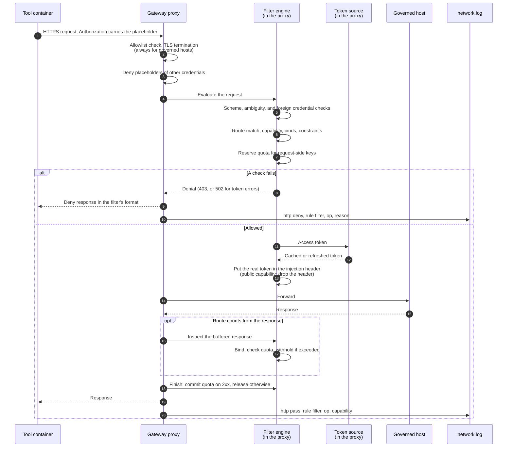

# Request filters: security concept

A request filter lets an agent use a third-party API through an unmodified
client while the gateway holds the credential and decides, request by request,
what reaches the API. This page states what filters guarantee, how each
guarantee is enforced, and what remains open. Usage is in
[Request filters](../filters.md), the policy language in the
[filter spec reference](../extensions/filter-spec.md).

## Threat model

The agent is assumed fully compromised, for example by prompt injection from a
mail it read. It can:

- run arbitrary code in the tool container and read every file and environment
  variable there, including the placeholder and the policy summary
- send arbitrary HTTP and HTTPS to allowlisted hosts, with any method, header,
  and body, and the placeholder in any position
- send many requests concurrently

It runs as the session's unprivileged user. Root could take the proxy's UID
and bypass the firewall rules below, so sessions that run the tool as root
or with sudo cannot select filters ([I10](#guarantees)).

Its goals are to obtain the credential, to call operations or reach resources
the preset does not grant, to exceed quotas, to use the governed API with a
token of its own as an exfiltration channel, and to find a request the filter
reads differently from the API.

Out of scope: host compromise, container escape, gateway vulnerabilities, bugs
of the API provider, abuse of capabilities within the bounds the preset grants,
and moving data the agent was allowed to read through other allowlisted hosts.
See [Residual risks](#residual-risks).

## Trust boundaries and assets

| Component | Trust | Holds |
|-----------|-------|-------|
| Host and the `enclave` binary | Trusted | Grants, OAuth client configuration, static credential sources, user presets, host config |
| Installed filter | Trusted after review at install ([Install-time review](#install-time-review)) | Spec and shipped presets, data only |
| Gateway sidecar | Trusted. A separate container: the tool shares its network namespace, not its filesystem or processes | Compiled policy, credential payload, access tokens, quota state |
| Tool container | Untrusted | Placeholder, read-only policy summary |
| Project directory and its `.env` | Untrusted | Nothing a filter reads |
| API provider | Trusted for its own semantics | The user's data |

The assets are the static secret, or the OAuth client secret and refresh
token, the access tokens minted from them, the integrity of the compiled policy
and its quota state, and the user's data behind the API.

## Request path

Every request to a governed host is terminated by the gateway's TLS proxy,
whatever `network_log` says, and evaluated by the filter engine inside the
proxy process before anything is forwarded.

Requests to other hosts carry no filter credential. Where the gateway inspects
them, a placeholder of an active filter in a header or the URL is denied
([Placeholder scope](#placeholder-scope)).

## Enforcement order

The firewall sends the session's TCP 80 and 443 to the proxy, and dnsmasq
adds the addresses governed names resolve to to a second ipset. Only the
proxy reaches those addresses, on TCP 80 and 443, matched by its UID. Every
other packet to them is rejected, so a request to a governed host cannot
bypass the filter over HTTP/3 or another port, for example with a token of
the agent's own.

For a request to a governed host:

1. The allowlist check runs first. Governed hosts join the session allowlist,
   and network policy applies keep them, so a filter host passes it unless a
   deny rule covers it, as for any host. A name below a confined domain that
   no filter governs fails it
   ([Request filter hosts](../networking.md#request-filter-hosts)).
2. The gateway picks the filter by `Host` header, then by TLS server name,
   among the names it governs ([Hosts](../extensions/filter-spec.md#hosts)).
   A placeholder of a credential release rule (another tool's or feature's
   credential) is denied with rule `secret-injection`. Release rules never
   inject on governed hosts.
3. The host must be governed, the scheme HTTPS, and the TLS server name equal
   to the `Host` header.
4. Ambiguity checks ([I5](#guarantees)): method override headers, `Upgrade`,
   trailers, repeated `Content-Type` or `Content-Encoding`, a body without a
   valid `Content-Type`, an opaque or user-info request target, characters
   outside RFC 3986, the path rules, and a query string that does not parse.
5. Foreign credential and placeholder checks ([I4](#guarantees),
   [I11](#guarantees)): `denyHeaders`, `denyParams`, the injection header,
   `Authorization`, and the placeholder in other headers and the URL. Then
   query parameter names outside `[A-Za-z0-9._~-]` are denied.
6. Routes match in order on method, host, path, parameter ambiguity, query
   conditions, and JSON and match conditions. The body is buffered only when
   a candidate route needs it. A body that a candidate's JSON conditions
   cannot read denies the request instead of skipping the route, and so do a
   body that is not a JSON object of a JSON media type and a key spelled
   like one the conditions read ([JSON bodies](#json-bodies)). No match
   denies with `no route for <METHOD> <host><path>`.
7. A deny route denies. A form body denies unless the route sets
   `allowFormBody`.
8. A capability the preset does not enable denies with
   `<op> needs capability <c>, not granted by preset 
`.
9. A non-public route without the injection header denies.
10. The body is read if a needed bind or `multipartParts` requires it, then
    request binds run and constraints are checked, with resolver lookups as
    needed.
11. Quota is reserved for request-side counts. Exceeding it denies with
    `quota <counter> exhausted (<limit>)`.
12. A public route loses its injection header and is forwarded without a
    credential. Any other route gets the real token in the injection header.
    A refresh failure denies with 502.
13. The request is forwarded. A route that counts from the response gets it
    unencoded and buffered, and the response is withheld and denied if it
    would exceed the quota or is a redirect. Quota commits on 2xx and 3xx and
    is released otherwise.
14. The decision is logged as an `http` event with rule `filter` and the
    fields `filter`, `op`, `capability`, and on denials `reason`
    ([What is recorded](../networking.md#what-is-recorded)).

## Guarantees

| ID | Guarantee | Enforced by |
|----|-----------|-------------|
| I1 | Real credential material (static secret, OAuth client secret, refresh token, access tokens) never enters the tool container: not in env, files, mounts, responses, logs, or deny messages | The credential payload is mounted only into the gateway, copied into the proxy's private directory on a tmpfs, never a container layer, and deleted from the host's temporary directory once the gateway is ready. The container gets the placeholder and a summary without placeholder or credential. Token errors carry only a sanitized OAuth error code. Credential and grant types redact themselves when formatted. `<state>/filters/` is never mounted, and Enclave's own roots cannot be added with `--add-dir` ([Sensitive mounts](../mounts.md#sensitive-mounts)) |
| I2 | Default deny: a request to a governed host is forwarded only if it matches a route whose capability the active preset enables and all of that capability's constraints pass | First-match route table, capability check, and constraint checks in the engine. A constraint whose variable the route does not bind passes only with `"*"`. Every name the allowlist entry of a governed host admits is governed, so none passes unchecked, and routes match their hosts exactly |
| I3 | The credential is added only to requests that passed I2, only over HTTPS, and only to governed hosts | Plain HTTP is denied before routing, and injection is the last step of evaluation. Release rules never inject on governed hosts. Resolver lookups use HTTPS URLs on governed hosts. The refresh token and client secret go only to the HTTPS `tokenUrl`, and at logout the refresh token only to `revokeUrl`. Neither the gateway's clients nor the host's OAuth client at login, import, and logout follow redirects |
| I4 | Foreign credentials are denied on governed hosts | An `Authorization` header that is not exactly the placeholder form, any `denyHeaders` header, any `denyParams` parameter in any folded spelling, and form bodies unless a route allows them. This blocks using the API with an attacker's token as an exfiltration channel |
| I5 | Ambiguous requests are denied | The checks in [Parsing hardening](#parsing-hardening), plus method override headers, `Upgrade`, trailers, compressed bodies that must be inspected, and bodies or responses over the inspection limit |
| I6 | Errors never grant | Bind, parse, resolver, and token errors deny. A body that a candidate route's JSON conditions cannot read denies too, so it never falls through to a later route. Policy or credential load errors stop the gateway, and startup errors stop the session |
| I7 | Quotas are never exceeded, also under concurrent requests | Reservations under one lock count pending requests. Content counted from a response is withheld if it would exceed the quota. A redirect commits like a 2xx response, or is withheld where the count comes from the response |
| I8 | Policy and credentials come only from the host | Filters load from the user extension root, presets from there and the host config directory, grants from the host state directory. A static credential resolves from the host environment, Enclave's secrets files, the env store, which is never mounted, and the declared host file. Project-local filters and presets never load. A project `.env` entry for a filter's env var is dropped with a warning. The summary mount is read-only |
| I9 | Filters are data only | The spec and presets are parsed strictly, keys case-sensitive. Nothing in a filter runs at install, build, or start, and nothing is staged into the build context or image hash. Other entries are reported as ignored. `commands/host/` keeps the rules of every kind ([Custom commands](../commands.md#commands-from-extensions)) |
| I10 | Selecting a filter where enforcement is impossible fails startup | Checked before the build when options resolve (the backend's `RequestFilters` capability, which only Docker and Podman report, a gateway, restricted mode including the policy files' mode, and no root or sudo in the tool container: no `--admin`, `--allow-root`, `--runtime-uid-remap`, or devcontainer `remoteUser` of root), again in the runtime, by `backend.Validate` and the QEMU backend, and by the Docker backend, the gateway start, and the proxy, which refuse filters without a restricted gateway. A running gateway never switches mode, and `network set-mode unrestricted` fails while a filtered session runs. `enclave exec --admin` into a filtered session fails |
| I11 | The placeholder works only in the injection header on governed hosts | On governed hosts the placeholder in another header, a header name, the path, or the query is denied. Requests to other hosts that carry it there are denied where the gateway inspects them. Bodies are not scanned, see [Placeholder scope](#placeholder-scope) |
| I12 | Logs and deny messages never contain header values, bodies, or credential material | Deny messages name the operation, capability, preset, constraint, and the offending value (a recipient or resource ID, quoted, at most 120 characters). The log records method, path without query, status, sizes, and the filter fields |

## Placeholder scope

I11 covers the headers and the URL of the traffic the gateway inspects:

- Every request to a governed name is inspected. The placeholder in a header
  other than the injection header, in a header name, in the path, or in the
  query is denied.
- Plaintext HTTP to allowlisted hosts is inspected, and so is HTTPS to hosts
  the gateway terminates for another reason: a credential release rule or
  `network_log=requests`. A placeholder in their headers or URL is denied
  with reason `placeholder`.
- Request bodies are not scanned, on governed hosts or elsewhere. A
  placeholder in a body is forwarded as it is, never replaced.
- TLS on port 443 to any other allowlisted host is tunnelled without
  termination, and traffic on other ports never reaches the proxy, so a
  placeholder sent there is not seen.

The gaps are accepted. The placeholder is not a secret: it is random per
filter and session, and worthless outside this session's gateway. The real
credential is only injected into the injection header of requests to
governed hosts that passed the filter ([I3](#guarantees)). Data the agent
sends to other allowlisted hosts is a general network policy concern
([Residual risks](#residual-risks)).

## Credential lifecycle

| Stage | Material and location | Protection |
|-------|-----------------------|------------|
| `filters login --client-secret <file>` | Client ID and secret in `<state>/filters/<filter>/client.json` | File 0600, directories 0700 |
| `filters login` | Authorization code flow with PKCE S256 and `state` on `127.0.0.1:<random port>`, 5 minute timeout. The refresh token lands in `<state>/filters/<filter>/grants/<id>.json` | File 0600, atomic write. Only the preset's scopes, minimized through `scopeImplies`, are requested |
| Session start | The host selects the covering grant with the fewest scopes, then the newest, and writes the policy and credential payload into a private temporary directory | Directory 0700, files 0600, mounted read-only into the gateway only |
| Gateway start | The entrypoint copies both files into the proxy's data directory, a tmpfs. The host deletes its temporary copy once the gateway is ready | Owned by the proxy user, files 0600, in memory only. Unexpected entries, symlinks, or an empty directory stop the gateway |
| Session | The proxy mints access tokens with the refresh token grant, caches each until 60 seconds before expiry, refreshes single-flight, backs off 2 seconds after a failure, and drops a token the API answered with 401 | Gateway memory only |
| Tool container | The placeholder in each `credential.env` variable, fresh per filter and session | Worthless outside this session's gateway |
| `filters logout` | The grant file is deleted and revoked at `revokeUrl` when the filter declares one, best effort. Not revoked: imported grants, whose refresh token the user's own client still holds, grants whose OAuth client another remaining grant uses, since providers such as Google revoke the whole authorization, and `--no-revoke` | |

A static credential is resolved on the host at session start, before the
build ([Static](../extensions/filter-spec.md#static)). From the payload on it
takes the same path. A refresh token the token endpoint rotates
is used in memory only and never written back.

## Data-only filters

The gateway holds the credential and runs with `NET_ADMIN` and `NET_RAW`. Code
supplied by a filter could read the credential there or rewrite any traffic,
so a filter carries no code. The engine in Enclave core interprets a bounded
policy language: routes, conditions, bind pipelines from a fixed set of steps,
three constraint kinds, resolvers, and counters. Installing a filter runs
nothing, and a filter never reaches an image.

Data still decides where the credential goes. Review these fields before
trusting a filter:

| Field | Receives |
|-------|----------|
| `hosts` | The access token or static secret, on allowed requests |
| `confine` | Nothing. It blocks names, and dropping it reopens them |
| `credential.oauth2.tokenUrl` | The refresh token and client secret, at every refresh |
| `credential.oauth2.authUrl` | The login in your browser |
| `credential.oauth2.revokeUrl` | The refresh token, at logout |
| `credential.static.env`, `credential.static.file` | Which host value is read and injected. Env aliases also resolve from Enclave's secrets files and the env store |
| `resolvers.<name>.url` | Credentialed `GET` lookups, on governed hosts only |
| `routes`, presets | What the agent may do |

## Install-time review

`enclave filters add` and `update` show the capability summary before writing
anything ([Capability summary](../extensions/installing.md#capability-summary)).
For a filter it lists host commands in the first row, then the governed hosts,
the confined domains, the credential type and injection header, the hosts of
the token, auth, and revoke endpoints or the static env aliases and file, the
union of OAuth scopes over capabilities and resolvers, the placeholder env
vars, the capabilities with public ones marked, and the presets with the
default marked.

An update diff leads with warnings, which `--json` reports in the result's
`warnings`:

- An endpoint that moves to a new host
- A new static env alias or file
- A newly governed host, which receives the credential
- A confined domain that is dropped, which reopens the names below it
- Any change to what an existing shipped preset enables, its constraint
  values, or its quotas. A widening cannot be told apart reliably, so every
  change counts

The diff lists added and removed operations as `<op> -> <capability>`, so a
route that moves to a broader capability shows up, and the changes per
preset. `filters list --json` reports the endpoint URLs and the static
sources
([Filter-only fields](../extensions/json-output.md#filter-only-fields)). All
three endpoints must be HTTPS URLs, or the spec does not load.

The summary does not show route conditions or constraint values. Read
`spec.yaml` for those, and `enclave filters show <name> --preset 
` for what
a preset enables.

## Parsing hardening

The engine denies every request form that an API server could read differently
from the filter.

### Request targets

- The path and query, as received and as forwarded, may hold only the
  characters RFC 3986 allows there: unreserved characters, sub-delims, `:`,
  `@`, `/`, `?` in the query, and valid percent-encoding. A raw `#` is
  denied: a server that reads it as the start of a fragment drops every
  parameter after it, such as a `format` the route matched on.
- A request with a body needs exactly one `Content-Type` that parses as
  `type/subtype` with valid parameters. Without one, a server may sniff the
  body.

### Paths

- The raw path must not contain `%2F`, `%5C`, or `%00` in any case, a
  backslash, an empty segment, a dot segment (also percent-encoded), invalid
  percent-encoding, or control characters.
- Segments are matched after decoding each one once. A trailing slash matches
  only a template that ends with one.

### Query parameters

- A query string that does not parse, for example with invalid
  percent-encoding or `;` separators, is denied.
- A parameter name that, decoded, holds a character outside
  `[A-Za-z0-9._~-]` is denied. Google APIs read `$alt`, `$fields`, and `$ct`
  like `alt`, `fields`, and the content type.
- A request parameter maps to a route parameter only by its exact name or, with
  `jsonKeys: protobuf`, by the exact snake_case alias (`add_parents` for
  `addParents`). Any other name that folds to a parameter the route constrains
  or binds is denied as ambiguous. Folding ignores case, `_`, whitespace, and
  control characters, since a server may read `Format` as `format`, or ignore
  it and fall back to a default the route does not allow.
- Every occurrence of a repeated parameter must satisfy its condition, and
  binds read all of them.
- `denyParams` match with the same folding.

### JSON bodies

- Duplicate keys at any depth, trailing data after the document, and nesting
  deeper than 256 levels are rejected. Numbers compare by value.
- With `jsonKeys: protobuf`, snake_case keys are renamed to lowerCamelCase
  before evaluation, the way protobuf JSON parsers read them, and two keys that
  name the same field are rejected.
- A route's JSON conditions read the body, or the first part of a
  `multipart/*` body. It must declare `application/json` or an
  `application/*+json` type, without a charset other than UTF-8, and hold a
  JSON object. Google APIs parse `application/json+protobuf` as JSPB, an
  array encoding in which no key a deny route looks for exists. If the body
  does not parse, repeats or collides keys, has another type or shape, or
  does not have the shape a path expects, the request is denied, so it
  cannot slip past a deny route to a broader allow route. An empty body or
  first part has every field absent.
- A key that folds like a name a path reads but is spelled differently, such
  as `WritersCanShare` for `writersCanShare`, denies the request as
  ambiguous. Folding ignores case, `_`, whitespace, and control characters,
  as for query parameters. It applies to every object a name step reads and
  every object a recursive descent passes, since a server may match keys
  case-insensitively, as Go's `encoding/json` does.
- A `json` bind step that reads the body, a multipart part, or the response
  needs the same JSON media type.

### Multipart bodies

Inspected `multipart/*` bodies follow RFC 2046 strictly and are denied for:

- a missing or invalid boundary, repeated parameters, RFC 2231 extended or
  continued parameters, quoted values with backslash escapes, and `start` or
  `start-info`, which can name another root part
- line endings other than CRLF, anything but whitespace before the first or
  after the last delimiter, text after a boundary on its line, or the
  boundary inside a part
- part headers other than `Content-Type`, `Content-Transfer-Encoding`, and
  `Content-Length`, a repeated one, a folded or whitespace-only header line,
  a name with whitespace before the colon, a `Content-Length` that does not
  match the part, or a `Content-Type` that does not parse. So neither a
  `Content-ID` nor a message header such as `To` can sit in a part header
  block, where a parser that ends the block elsewhere would read it.
- a nested multipart part, more than 64 parts, or a part count other than
  the route's `multipartParts`
- a `Content-Transfer-Encoding` other than `7bit`, `8bit`, or `binary`. With
  quoted-printable, `=54o:` reads as `To:` upstream.

A content type selector checks the first part, which servers such as Google's
upload endpoints read as metadata, never a later part of the same type.

### Encodings

- A request body that must be inspected is denied with a `Content-Encoding`
  other than `identity`, and is forwarded with `Content-Length` after
  buffering.
- A route that counts from the response requests it without
  `Accept-Encoding`, denies an encoded response, and relays the buffered body
  with a correct `Content-Length` and without `Content-Encoding`.
- The `base64url` step accepts the URL-safe and the standard alphabet, padding
  optional, and rejects whitespace.

### Mail recipients

The `rfc822` step parses the header block itself, up to the first empty line:

- Recipients are collected from every field whose name, trimmed of trailing
  whitespace and compared case-insensitively, is `To`, `Cc`, `Bcc`,
  `Resent-To`, `Resent-Cc`, or `Resent-Bcc`. So `Bcc :` counts.
- Denied: mixed CRLF and LF line endings, a bare CR, NUL, a line without a
  colon, an empty field name or one with whitespace, control, or non-ASCII
  characters or an encoded word, a folded first line, a whitespace-only folded
  line, an unresolvable group, leading comments, and source routes.
- `Delivered-To` and `X-Original-To` are ignored on purpose: they never add a
  recipient.
- The `destinations` mode also reads `Reply-To`, `Mail-Reply-To`,
  `Mail-Followup-To`, `Disposition-Notification-To`, `Return-Receipt-To`,
  and `Errors-To`, whose addresses receive replies, receipts, and bounces.
  `From` and `Sender` are not read: they name the account, and Gmail
  replaces an address the account does not own.
- Addresses are lowercased in ASCII only. Email patterns match ASCII
  case-insensitively, without Unicode case folding, and a non-ASCII domain
  never matches a pattern.

### Form bodies

`application/x-www-form-urlencoded` and `multipart/form-data` bodies are denied
unless the route sets `allowFormBody: true`. Servers may read parameters,
credentials included, from them as from the query string.

### Resource IDs

A value checked against `within` is looked up only if it matches
`[A-Za-z0-9._~-]+`, is at most 512 characters, and is not `.` or `..`. It is
path-escaped into the resolver URL. A walk stops at `maxDepth` levels or 128
lookups per value.

## Quotas

- Request-side keys, such as a message ID from the path, are reserved under one
  lock before the request is forwarded. Pending reservations count, so
  concurrent requests cannot overshoot the limit.
- Reservations commit on a 2xx or 3xx response and are released on any other
  status, on upstream errors, and on denials. A redirect commits since its
  target may serve the content without the filter. A route that counts from
  the response withholds a redirect, which it cannot count.
- A keyed counter counts distinct values, so reading one message twice costs
  one unit. An unkeyed counter counts allowed requests.
- Counts taken from a response, such as the message IDs of a thread, are
  checked before the response is relayed. If they would exceed the quota, the
  response is withheld and denied. The upstream request has run by then.
- A quota of 0 blocks every request the counter counts. A counter without a
  quota in the preset is not tracked.
- The quota status is 403 with `RESOURCE_EXHAUSTED`, never 429: clients retry
  on 429 and would hammer the gateway for the rest of the session.
- Quota state lives in the proxy's memory for the session. A network policy
  apply reloads the gateway: dnsmasq restarts, while the proxy gets `SIGHUP`,
  swaps in the new allowlist, and closes the connections it holds, but keeps
  running, so the state survives.

## Fail-closed behavior

- Session start fails, before any image build, on every problem listed in
  [Startup checks](../filters.md#startup-checks): no covering grant, a
  missing static credential, a backend or network mode that cannot enforce,
  and host or env var collisions.
- The gateway validates the compiled policy and credential strictly, unknown
  fields included, and does not start on any error.
- A failed token refresh denies with 502 `UNAVAILABLE`, logged with reason
  `token:<cause>`. The message names `enclave filters login` only when the
  grant or client was rejected (`invalid_grant`, `unauthorized_client`,
  `invalid_client`).
- A failed first resolver lookup fails the constraint, logged with reason
  `resolver:<cause>`. A failure further up ends that branch of the walk as
  if it reached the top. Neither grants. Causes are categories such as
  `http-404` or `unreachable`, never response content.
- A restricted gateway shuts down when its proxy exits, or when a reload
  fails, which takes the session offline, since the session shares the
  gateway's network namespace.
- A reload rebuilds the firewall under a drop policy and installs the proxy
  redirects and the governed rejects before any rule accepts an allowlisted
  address, so no connection slips past the proxy while it runs.

## Residual risks

- Abuse within granted capabilities: a preset that may send mail inside the
  company allows internal phishing, one that may edit every file allows
  vandalism. Pick the narrowest preset and set quotas.
- Exfiltration through other allowlisted hosts: data the agent may read
  through the filter can leave through any other allowlisted host, such as
  the model API or a code forge. This is a general network policy concern
  ([Network boundary](README.md#network-boundary)).
- Allowlisted hosts outside the filter accept foreign tokens. A broad entry
  such as `googleapis.com` from another allowlist fragment lets the agent use
  its own token against Google APIs the filter does not govern. Over UDP or
  other ports to such a host's address, the agent may also name a governed
  host in TLS, which a front end the two share may serve. On TCP 443 the
  gateway tunnels TLS to such a host without terminating it, so a governed
  name in the `Host` header inside that TLS (domain fronting) is not seen
  either. The user's credential never reaches them (I3, I11). A filter that
  [confines](../extensions/filter-spec.md#confine) the parent closes these
  paths below it, and its governed hosts stay reachable. A deny rule for the
  parent closes them too, but also blocks the governed hosts below it.
- A placeholder sent to an allowlisted host whose TLS the gateway tunnels,
  or in any request body, is not denied
  ([Placeholder scope](#placeholder-scope)). It is worthless there.
- Route table mistakes: an operation mapped to the wrong capability, a missing
  deny route, or an endpoint that echoes the token makes the filter allow more
  than intended. OAuth scopes are the second layer. A session uses the
  narrowest covering grant, so log in per preset to keep that layer tight.
- Quota counters reset when the session or its gateway restarts, and parallel
  sessions each get their own quota.
- A rotated refresh token is kept in memory only. If the provider invalidates
  the stored one, the next session fails to refresh and needs a new login.
- Responses are not filtered: a list operation returns every entry the API
  returns, and only response-counted routes are inspected at all.
